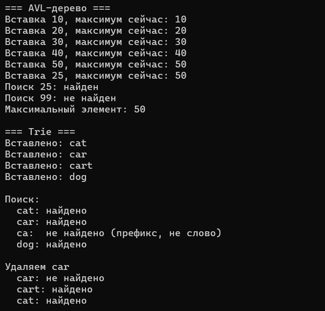
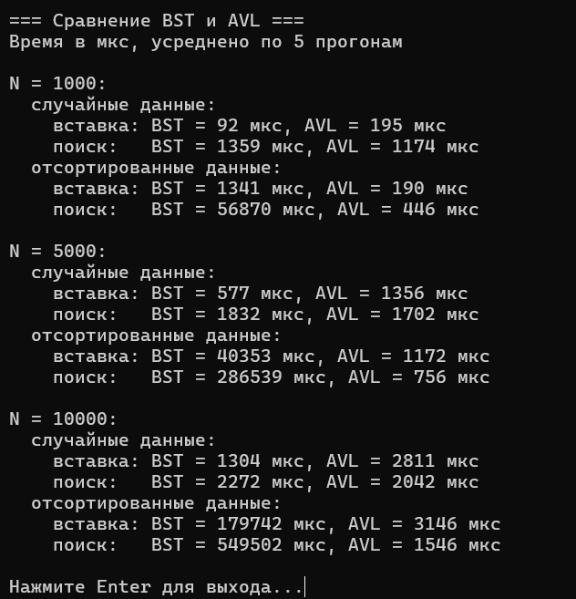

# Лабораторная работа №10: AVL-дерево. Префиксное дерево (Trie)

Студент: Лещинский П.А.

Группа: ПИЖ-б-о-25-2(2)

Вариант: 2

Дисциплина: «Алгоритмы и структуры данных»

Тема: «AVL-дерево. Префиксное дерево (Trie)»

---

## Цель работы

1. Реализовать самобалансирующееся AVL-дерево с операциями вставки, удаления и поиска.
2. Освоить механизмы балансировки: малые и большие повороты (правый, левый, правый-левый, левый-правый).
3. Изучить структуру данных «префиксное дерево» (Trie) для эффективного хранения и поиска строк.
4. Реализовать операции вставки, поиска и удаления в Trie.
5. Сравнить производительность AVL-дерева, BST и Trie для различных типов данных.

---

## Теоретическая часть

AVL-дерево – самобалансирующееся бинарное дерево поиска, в котором разница высот левого и правого поддеревьев каждого узла не превышает 1. Эта разница называется фактором баланса. Если после вставки или удаления фактор выходит за пределы −1, 0, 1, выполняется поворот: правый, левый, левый-правый или правый-левый. Повороты восстанавливают баланс за O(1), поэтому вставка, поиск и удаление остаются O(log n) даже в худшем случае, в отличие от обычного BST, который на отсортированных данных вырождается в список.

Trie (префиксное дерево) хранит строки посимвольно: каждый узел соответствует одному символу, путь от корня задаёт префикс, флаг `isEndOfWord` отмечает конец слова. Вставка и поиск работают за O(L), где L – длина строки, независимо от количества слов. Удаление требует аккуратности: сначала снимается флаг конца слова, затем по пути вверх удаляются узлы, у которых нет детей и которые не являются концом другого слова.

---

## Постановка задачи

Вариант 2.

Часть 1 – AVL-дерево: тип ключа int, обязательные операции – вставка, балансировка. Дополнительно – поиск максимального элемента.

Часть 2 – префиксное дерево (Trie): обязательные операции – вставка, поиск. Дополнительно – удаление слова.

Часть 3 – сравнительный анализ: сравнить производительность вставки и поиска в AVL и BST для N = 1000, 5000, 10000 на случайных и отсортированных данных. Построить таблицу зависимости времени от N.

---

## Листинг программы с комментариями

Ссылки на файлы в репозитории:

https://github.com/Fanatol/cpp-labs/blob/main/lab3-10/AVL.h

https://github.com/Fanatol/cpp-labs/blob/main/lab3-10/BST.h

https://github.com/Fanatol/cpp-labs/blob/main/lab3-10/Trie.h

https://github.com/Fanatol/cpp-labs/blob/main/lab3-10/main.cpp

---

## Результаты работы

Результаты выполнения программы представлены на скриншотах.

Рисунок 1 – Демонстрация AVL-дерева и Trie

Рисунок 2 – Сравнение производительности BST и AVL

---

## Сравнительная таблица производительности

Замеры в мкс, усреднено по 5 прогонам, 20000 запросов поиска.

| N | Данные | Операция | BST | AVL |
|---|---|---|---|---|
| 1000 | случайные | вставка | 93 | 192 |
| 1000 | случайные | поиск | 1253 | 1160 |
| 1000 | отсортированные | вставка | 1374 | 192 |
| 1000 | отсортированные | поиск | 57850 | 449 |
| 5000 | случайные | вставка | 568 | 1276 |
| 5000 | случайные | поиск | 1837 | 1763 |
| 5000 | отсортированные | вставка | 39640 | 1088 |
| 5000 | отсортированные | поиск | 279665 | 668 |
| 10000 | случайные | вставка | 1373 | 3003 |
| 10000 | случайные | поиск | 2471 | 2067 |
| 10000 | отсортированные | вставка | 179656 | 2810 |
| 10000 | отсортированные | поиск | 577770 | 1063 |

---

## Ответы на контрольные вопросы

1. Что такое AVL-дерево? В чём его отличие от обычного BST?

Самобалансирующееся BST. Отличается тем, что после каждой операции проверяет фактор баланса и при необходимости выполняет повороты. Высота всегда O(log n), тогда как BST может выродиться в список.

2. Что такое фактор баланса? Как он вычисляется?

Разница высот левого и правого поддеревьев: `height(left) − height(right)`. Допустимые значения – −1, 0, 1. Выход за пределы означает разбалансировку.

3. Какие существуют типы поворотов в AVL-дереве?

Правый, левый, левый-правый, правый-левый. Два последних – комбинация двух простых поворотов при зигзагообразном перевесе.

4. Когда применяется правый поворот? Левый поворот?

Правый – при факторе > 1 и неотрицательном факторе левого потомка. Левый – при факторе < −1 и неположительном факторе правого потомка.

5. Когда применяется левый-правый поворот? Правый-левый?

Левый-правый – при факторе > 1 и отрицательном факторе левого потомка. Правый-левый – при факторе < −1 и положительном факторе правого потомка.

6. Какова сложность операций в AVL-дереве?

Поиск, вставка, удаление – O(log n) в среднем и худшем случае. Повороты за O(1), но на каждом уровне рекурсии обновляется высота.

7. Почему AVL-дерево называется самобалансирующимся?

Оно автоматически поддерживает баланс после каждой операции. Пользователь вызывает только insert/remove, повороты и обновление высот происходят внутри.

8. Как часто происходит балансировка при вставке?

Не на каждом шаге. Большинство вставок баланс не нарушают. Поворот выполняется только когда фактор выходит за пределы допустимого.

9. Чем AVL-дерево отличается от красно-чёрного дерева?

AVL строже балансируется (разница высот не больше 1), поэтому поиск чуть быстрее, но вставка и удаление дороже из-за частых поворотов. Красно-чёрное дерево допускает больший дисбаланс, поэтому вставка/удаление быстрее, поиск чуть медленнее.

10. В каких случаях AVL-дерево эффективнее BST?

Когда данные вставляются в отсортированном или близком к отсортированному порядке. BST в этом случае вырождается в список, а AVL сохраняет логарифмическую высоту.

11. Что такое Trie (префиксное дерево)? Для решения каких задач оно используется?

Дерево, где каждый узел – символ, путь от корня – префикс. Используется для автодополнения, проверки орфографии, поиска по префиксу, IP-маршрутизации.

12. Какова сложность поиска в Trie? От чего она зависит?

O(L), где L – длина строки. Не зависит от количества слов в дереве. Зависит только от длины искомого слова.

13. Какая структура данных эффективнее для строк: Trie или хеш-таблица?

Хеш-таблица быстрее для точного поиска (O(1) в среднем), Trie – для префиксных операций (автодополнение, поиск по префиксу). Trie также даёт лексикографический порядок.

14. Как реализовать автодополнение с помощью Trie?

Спуститься по префиксу до узла, затем собрать все слова в поддереве этого узла (рекурсивный обход с накоплением строки). Обычно ограничивают топ-N по частоте.

15. Каковы недостатки Trie? Какой объём памяти он требует?

Требует много памяти: каждый узел хранит массив детей размером с алфавит (26 указателей для латиницы). Для больших алфавитов или длинных строк память растёт быстро. Решение – сжатое префиксное дерево (Radix Tree) или хеш-таблица детей.

---

## Вывод

В ходе работы реализовано AVL-дерево с вставкой, балансировкой (все четыре типа поворотов) и поиском максимального элемента, а также Trie с вставкой, поиском и корректным удалением слова (с очисткой пустых узлов по пути вверх).

Проведён сравнительный анализ BST и AVL для N = 1000, 5000, 10000. На случайных данных BST и AVL показывают сопоставимые результаты: оба дерева в среднем сбалансированы. На отсортированных данных BST вырождается в список и время поиска растёт линейно (до 577770 мкс при N = 10000), тогда как AVL остаётся логарифмическим (1063 мкс). AVL немного проигрывает BST по времени вставки на случайных данных из-за накладных расходов на балансировку, но это компенсируется стабильностью на любых входных данных. 

---

## Ссылка на Git-репозиторий

https://github.com/Fanatol/cpp-labs/tree/main/lab3-10