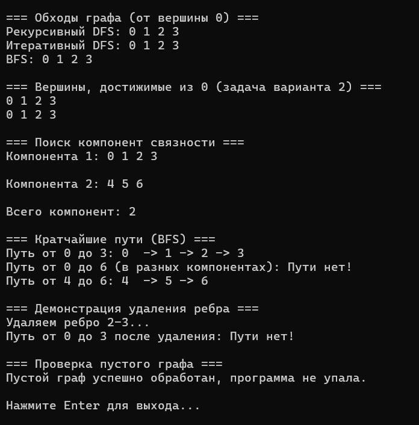

# Лабораторная работа №11: Представление графов. DFS и BFS

Студент: Лещинский П.А.

Группа: ПИЖ-б-о-25-2(2)

Вариант: 2

Дисциплина: «Алгоритмы и структуры данных»

Тема: «Представление графов. DFS и BFS»

---

## Цель работы

1. Изучить способы представления графов в памяти компьютера: матрица смежности и список смежности.
2. Освоить алгоритмы обхода графа: поиск в глубину (DFS) и поиск в ширину (BFS).
3. Научиться применять DFS и BFS для решения практических задач (поиск компонент связности, кратчайших путей).
4. Проанализировать сложность алгоритмов для разных способов представления графа.
5. Сравнить эффективность матрицы смежности и списка смежности.

---

## Теоретическая часть

Граф – это совокупность вершин и рёбер между ними. В неориентированном графе рёбра не имеют направления. В невзвешенном графе рёбра не имеют весов.

Матрица смежности – это квадратная матрица V×V, где `matrix[i][j] = 1`, если есть ребро между i и j. Для неориентированного графа матрица симметрична. Плюс – проверка ребра за O(1), минус – память O(V²).

DFS (поиск в глубину) идет по одной ветке до упора, затем возвращается. Реализуется рекурсивно или через стек. BFS (поиск в ширину) идет слоями с помощью очереди. BFS позволяет находить кратчайший путь в невзвешенном графе.

---

## Постановка задачи

Часть 1 – представление графа: матрица смежности, неориентированный граф, без весов.

Часть 2 – обход графа: рекурсивный DFS, итеративный DFS, BFS. Дополнительная задача – найти все вершины, достижимые из заданной.

Часть 3 – применение обходов: нахождение компонент связности, поиск кратчайшего пути (BFS).

---

## Листинг программы с комментариями

Ссылки на файлы в репозитории:

https://github.com/Fanatol/cpp-labs/blob/main/lab3-11/GraphMatrix.h

https://github.com/Fanatol/cpp-labs/blob/main/lab3-11/main.cpp

---

## Результаты работы

Результаты выполнения программы представлены на скриншоте.

Рисунок 1 – Демонстрация работы графа, обходов и поиска путей

---

## Ответы на контрольные вопросы

1. Что такое граф? Из каких элементов он состоит?

Граф – это математическая структура, представляющая собой совокупность вершин (узлов) и рёбер (связей) между ними. Элементы: вершины (объекты) и рёбра (отношения между объектами).

2. Чем отличается ориентированный граф от неориентированного?

В ориентированном графе рёбра (дуги) имеют направление, связь действует в одну сторону. В неориентированном графе рёбра не имеют направления, связь двусторонняя (если A связана с B, то и B связана с A).

3. Что такое матрица смежности? Каковы её достоинства и недостатки?

Это квадратная матрица V×V, где 1 означает наличие ребра, а 0 – его отсутствие. Достоинства: проверка наличия ребра за O(1), простота. Недостатки: занимает O(V²) памяти, что неэффективно для разреженных графов; поиск всех соседей вершины занимает O(V).

4. Что такое список смежности? Каковы его достоинства и недостатки?

Это массив списков, где для каждой вершины хранятся только её соседи. Достоинства: эффективное использование памяти O(V + E), быстрый перебор соседей. Недостатки: проверка наличия конкретного ребра занимает O(deg(v)), что может быть медленнее матрицы.

5. В каких случаях лучше использовать матрицу смежности, а в каких - список смежности?

Матрицу смежности лучше использовать для плотных графов (когда рёбер много, близко к V²), где важна быстрая проверка наличия конкретного ребра. Список смежности лучше для разреженных графов (рёбер мало), так как экономит память и позволяет быстро перебирать соседей.

6. Какова сложность проверки наличия ребра в матрице смежности? В списке смежности?

В матрице смежности – O(1), так как это просто обращение к элементу массива по индексам. В списке смежности – O(deg(v)), так как нужно просмотреть список соседей вершины v в поисках нужного.

7. Какова сложность перебора всех соседей вершины в матрице смежности? В списке смежности?

В матрице смежности – O(V), так как нужно просмотреть всю строку матрицы, соответствующую вершине. В списке смежности – O(deg(v)), так как мы просто идем по списку соседей этой вершины.

8. Что такое поиск в глубину (DFS)? Как он работает?

Это алгоритм обхода графа, который идет по одной ветке как можно глубже, пока не достигнет тупика, после чего возвращается назад и исследует другие ветки. Использует стек (явный или неявный стек вызовов при рекурсии) и массив посещенных вершин.

9. Какие задачи решаются с помощью DFS?

Поиск компонент связности, проверка наличия цикла, топологическая сортировка, поиск мостов и точек сочленения, поиск любого пути между вершинами.

10. Что такое поиск в ширину (BFS)? Как он работает?

Это алгоритм обхода графа, который исследует граф слоями: сначала всех прямых соседей стартовой вершины, затем соседей соседей и так далее. Использует очередь и массив посещенных вершин.

11. Какие задачи решаются с помощью BFS?

Поиск кратчайшего пути в невзвешенном графе, поиск компонент связности, проверка двудольности графа, нахождение всех вершин на заданном расстоянии от стартовой.

12. В чём отличие рекурсивной реализации DFS от итеративной?

Рекурсивная использует неявный стек вызовов функций, что делает код короче и читаемее, но может привести к переполнению стека на больших графах. Итеративная использует явную структуру данных `std::stack`, что позволяет избежать переполнения стека вызовов и дает больше контроля над процессом.

13. Почему BFS находит кратчайший путь в невзвешенном графе, а DFS - нет?

BFS исследует граф строго по уровням (слоям), поэтому гарантированно достигает целевой вершины за минимальное количество шагов (рёбер). DFS же уходит вглубь по первой попавшейся ветке и может найти длинный путь, хотя существует более короткий через другую ветку.

14. Как найти компоненты связности графа с помощью DFS?

Нужно запустить цикл по всем вершинам. Если вершина еще не посещена, значит, мы нашли новую компоненту связности. Запускаем из нее DFS, который обойдет и пометит все вершины этой компоненты. Затем продолжаем цикл, пропуская уже посещенные вершины.

15. Как проверить наличие цикла в графе с помощью DFS?

При обходе нужно отслеживать не только посещенные вершины, но и вершины, которые находятся в текущем стеке рекурсии (в процессе обработки). Если во время DFS мы встречаем соседа, который уже находится в стеке (а не просто посещен), значит, в графе есть цикл.

---

## Вывод

В ходе работы был реализован класс для представления неориентированного графа с помощью матрицы смежности. Освоены и реализованы алгоритмы обхода: рекурсивный DFS, итеративный DFS (с использованием стека) и BFS (с использованием очереди).

С помощью обходов решены прикладные задачи: поиск всех вершин, достижимых из заданной (доп. задание варианта 2), поиск компонент связности, а также нахождение кратчайшего пути в невзвешенном графе с восстановлением маршрута. Программа корректно обрабатывает графы с разным числом компонент, удаление рёбер и пустые графы.

---

## Ссылка на Git-репозиторий

https://github.com/Fanatol/cpp-labs/tree/main/lab3-11