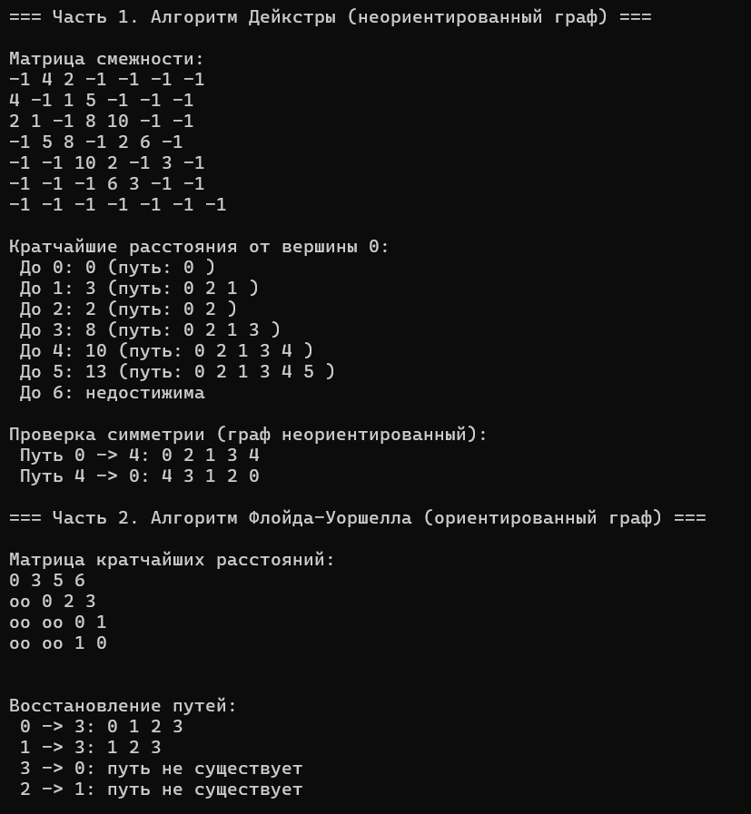
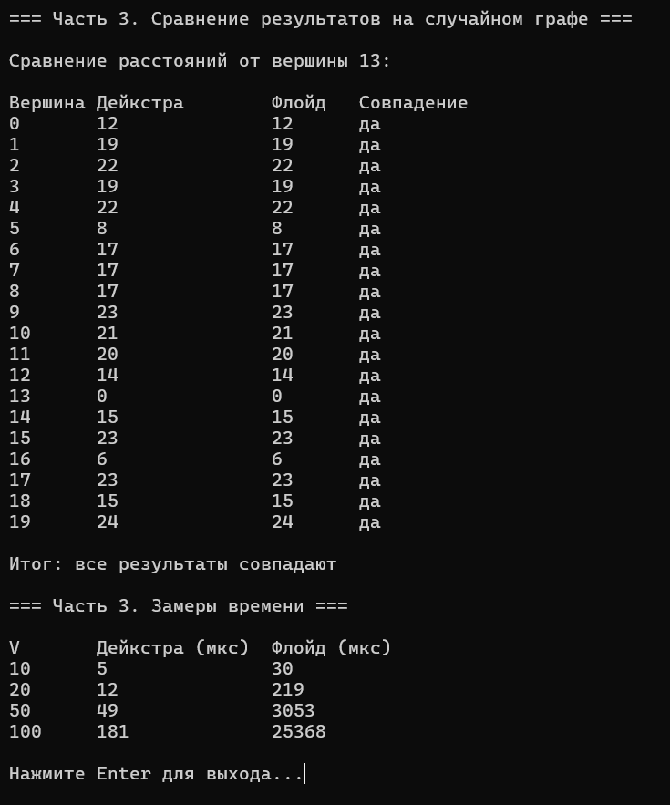

# Лабораторная работа №12: Кратчайшие пути. Дейкстра и Флойд-Уоршелл

Студент: Лещинский П.А.

Группа: ПИЖ-б-о-25-2(2)

Вариант: 2

Дисциплина: «Алгоритмы и структуры данных»

Тема: «Кратчайшие пути. Дейкстра и Флойд-Уоршелл»

---

## Цель работы

1. Изучить алгоритмы поиска кратчайших путей во взвешенных графах: алгоритм Дейкстры и алгоритм Флойда-Уоршелла.
2. Освоить реализацию алгоритма Дейкстры с использованием приоритетной очереди (priority_queue) на основе матрицы смежности.
3. Освоить алгоритм Флойда-Уоршелла для нахождения кратчайших расстояний между всеми парами вершин с восстановлением путей.
4. Проанализировать и сравнить вычислительную сложность алгоритмов Дейкстры и Флойда-Уоршелла.
5. Сравнить эффективность алгоритмов на практике при разных размерах графа.

---

## Теоретическая часть

Взвешенный граф – это граф, каждому ребру которого присвоен числовой вес. В ориентированном графе рёбра имеют направление, в неориентированном – связь двусторонняя. Задача о кратчайшем пути – найти маршрут между вершинами с минимальной суммой весов рёбер.

Алгоритм Дейкстры находит кратчайшие пути от одной вершины до всех остальных. Работает только для графов без отрицательных весов. Идея: жадно выбирается непосещённая вершина с минимальным расстоянием, и через неё выполняется релаксация (улучшение) расстояний до соседей. С приоритетной очередью сложность составляет O((V + E)·log V). Путь восстанавливается по массиву предков prev: идём от конечной вершины к начальной, затем разворачиваем маршрут.

Алгоритм Флойда-Уоршелла находит кратчайшие расстояния между всеми парами вершин сразу. Основан на динамическом программировании: для каждой вершины k проверяется, не становится ли путь i → k → j короче прямого пути i → j. Сложность O(V³), память O(V²). Для восстановления путей хранится матрица next: next[i][j] – следующая вершина на кратчайшем пути из i в j. Путь собирается от старта к финишу переходами по next.

---

## Постановка задачи

Часть 1 – кратчайшие пути от одной вершины: алгоритм Дейкстры с приоритетной очередью, неориентированный взвешенный граф, вывод расстояний и восстановление пути.

Часть 2 – кратчайшие пути между всеми парами вершин: алгоритм Флойда-Уоршелла, ориентированный взвешенный граф, восстановление путей. Дополнительно – вывод матрицы кратчайших расстояний (вариант 2).

Часть 3 – сравнение алгоритмов: проверка совпадения результатов на случайном графе из 20 вершин, замер времени работы для V = 10, 20, 50, 100, таблица и график зависимости времени от числа вершин, выводы об эффективности.

---

## Листинг программы с комментариями

Ссылки на файлы в репозитории:

https://github.com/Fanatol/cpp-labs/blob/main/lab3-12/Graph.h

https://github.com/Fanatol/cpp-labs/blob/main/lab3-12/main.cpp

---

## Результаты работы

Результаты выполнения программы представлены на скриншотах.

Рисунок 1 – Дейкстра на неориентированном графе и Флойд-Уоршелл на ориентированном графе

Рисунок 2 – Сравнение результатов алгоритмов и замеры времени

---

## Ответы на контрольные вопросы

1. Что такое взвешенный граф?

Это граф, каждому ребру которого присвоено числовое значение (вес) – стоимость, длина или время прохождения. Вес может обозначать расстояние между городами, цену перевозки и т.п. В лабораторной работа ведётся с матрицей смежности, где вес ребра хранится в соответствующей клетке, а −1 означает отсутствие ребра.

2. В чём состоит задача о кратчайшем пути?

Найти между двумя вершинами графа маршрут с минимальной суммой весов рёбер. Варианты постановки: путь от одной вершины до всех остальных (одиночный источник) или кратчайшие пути между всеми парами вершин сразу.

3. В чём основная идея алгоритма Дейкстры?

Жадный алгоритм: на каждом шаге из ещё не обработанных вершин выбирается вершина с минимальным текущим расстоянием – она финализируется, так как лучше уже не станет (веса неотрицательны). Затем через неё улучшаются (релаксируются) расстояния до её соседей. Процесс повторяется, пока все вершины не обработаны.

4. Почему алгоритм Дейкстры не работает с отрицательными весами?

Он основан на предположении, что добавленная к пути вершина с минимальным расстоянием уже имеет окончательное значение. Отрицательное ребро может позже уменьшить расстояние до «финализированной» вершины, и жадный выбор перестаёт быть оптимальным. Для отрицательных весов нужен алгоритм Беллмана-Форда.

5. Зачем в алгоритме Дейкстры используется приоритетная очередь?

Чтобы за O(log V) получать вершину с минимальным текущим расстоянием вместо линейного поиска за O(V). Это снижает общую сложность с O(V²) до O((V + E)·log V). В реализации используется std::priority_queue с компаратором std::greater, который делает очередь мин-кучей.

6. Что такое релаксация ребра?

Попытка улучшить расстояние до вершины: если путь через текущую вершину (dist[v] + вес ребра v→i) оказывается меньше текущего расстояния dist[i], то расстояние обновляется, а предком вершины i запоминается v. Релаксация – базовая операция всех алгоритмов кратчайших путей.

7. Как восстановить путь в алгоритме Дейкстры?

По массиву предков prev: из конечной вершины идём по ссылкам prev до стартовой, попутно записывая вершины, затем разворачиваем полученную последовательность, так как она собрана от конца к началу. Если prev конечной вершины равен −1 (и это не старт), пути не существует.

8. В чём основная идея алгоритма Флойда-Уоршелла?

Динамическое программирование: поочерёдно для каждой вершины k проверяем, не становится ли путь из i в j короче, если пройти через k: если dist[i][k] + dist[k][j] < dist[i][j], то значение обновляется. После перебора всех k матрица содержит кратчайшие расстояния между всеми парами вершин.

9. Какова сложность алгоритма Флойда-Уоршелла и почему?

O(V³) по времени: три вложенных цикла по всем вершинам. Память – O(V²) под матрицу расстояний. Независимо от плотности графа алгоритм всегда выполняет V³ итераций, поэтому на больших разреженных графах проигрывает многократному запуску Дейкстры.

10. Как восстановить путь в алгоритме Флойда-Уоршелла?

Хранится матрица next, где next[i][j] – первая вершина после i на кратчайшем пути из i в j. При обновлении расстояния через вершину k выполняется next[i][j] = next[i][k]. Путь собирается от старта к финишу: текущая вершина заменяется на next[текущая][финиш], пока не достигнут финиш. Разворачивать маршрут не нужно.

11. Чем отличается восстановление пути в Дейкстре и во Флойде-Уоршелле?

В Дейкстре хранятся предки, поэтому путь собирается от конца к началу и требует разворота. Во Флойде хранится матрица «следующих вершин», поэтому путь собирается от начала к концу без разворота. Кроме того, Дейкстра восстанавливает пути от одной вершины, а Флойд – между всеми парами сразу.

12. Когда выгоднее применять Дейкстру, а когда Флойда-Уоршелла?

Если нужны пути только от одной вершины, Дейкстра эффективнее: O((V + E)·log V) против O(V³). Флойд оправдан, когда требуются расстояния между всеми парами вершин и граф небольшой: одно выполнение Флойда быстрее, чем V запусков Дейкстры, примерно при плотных графах и малых V. Также Флойд проще в реализации и умеет обнаруживать отрицательные циклы.

13. Как в программе обрабатываются недостижимые вершины?

В Дейкстре недостижимая вершина остаётся с расстоянием INT_MAX, при выводе печатается «недостижима», а метод восстановления пути возвращает пустой вектор. Во Флойде недостижимость обозначается значением INF = INT_MAX/2, при печати матрицы оно заменяется на «oo», а проверка dist[i][k] != INF в основном цикле не позволяет выполнять сложение с «бесконечностью» и избежать переполнения.

14. Как в программе учитывается ориентированность графа?

Класс Graph хранит флаг isDirected. Методы addEdge и removeEdge проверяют его: в неориентированном графе ребро записывается (удаляется) симметрично в обе клетки матрицы, в ориентированном – только в одну. Благодаря этому один и тот же класс работает с обоими типами графов, что и показано в частях 1 и 2 работы.

15. Какие результаты показало сравнение алгоритмов на практике?

На случайном графе из 20 вершин расстояния от одной вершины, полученные Дейкстрой и Флойдом, совпали для всех вершин. Замеры времени подтвердили теорию: время Дейкстры растёт примерно квадратично (5, 12, 49, 181 мкс при V = 10, 20, 50, 100), а Флойда – кубически (30, 219, 3053, 25368 мкс). При V = 100 Флойд медленнее примерно в 140 раз, и разрыв увеличивается с ростом графа.

---

## Вывод

В ходе работы реализован класс взвешенного графа на матрице смежности с поддержкой ориентированных и неориентированных графов. Освоены и реализованы два алгоритма кратчайших путей: Дейкстра с приоритетной очередью (расстояния от одной вершины с восстановлением пути по массиву предков) и Флойд-Уоршелл (матрица расстояний между всеми парами вершин с восстановлением путей по матрице next).

Выполнено дополнительное задание варианта 2 – вывод матрицы кратчайших расстояний с заменой бесконечности на «oo». Корректность алгоритмов подтверждена перекрёстной проверкой на случайном графе из 20 вершин: результаты совпали полностью. Замеры времени показали соответствие теории: квадратичный рост Дейкстры против кубического роста Флойда-Уоршелла; практический вывод – для путей от одной вершины выгодна Дейкстра, Флойд оправдан при необходимости всех пар расстояний на небольшом графе.

---

## Ссылка на Git-репозиторий

https://github.com/Fanatol/cpp-labs/tree/main/lab3-12
