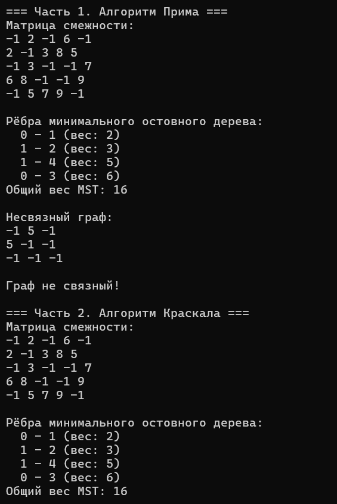
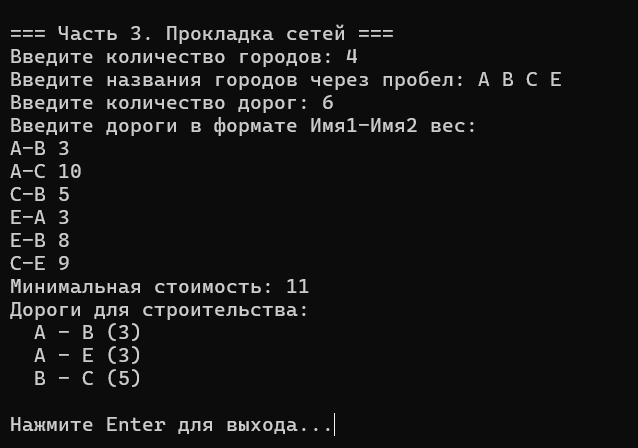

# Лабораторная работа №13: Минимальные остовные деревья. Алгоритмы Прима и Краскала

Студент: Лещинский П.А.

Группа: ПИЖ-б-о-25-2(2)

Вариант: 2

Дисциплина: «Алгоритмы и структуры данных»

Тема: «Минимальные остовные деревья»

---

## Цель работы

1. Изучить понятие минимального остовного дерева (Minimum Spanning Tree, MST) и его применение
2. Реализовать алгоритм Прима для построения MST в связном взвешенном графе
3. Реализовать алгоритм Краскала для построения MST с использованием системы непересекающихся множеств (DSU)
4. Сравнить эффективность алгоритмов Прима и Краскала на различных типах графов
5. Научиться применять MST для решения практических задач (сети связи, дорожные сети)

---

## Теоретическая часть

Остовное дерево (каркас) – это подграф, содержащий все вершины исходного графа и ровно V − 1 ребро, при этом не содержащий циклов. Для взвешенного графа минимальным остовным деревом (MST) называется остов с минимальной суммой весов рёбер. MST существует тогда и только тогда, когда граф связный. MST может быть не единственным при наличии рёбер равного веса, но суммарный вес минимален у любого из них.

Алгоритм Прима строит дерево «нарастанием»: дерево начинается с произвольной стартовой вершины, и на каждом шаге к нему присоединяется вершина, соединённая с деревом ребром минимального веса. Приоритетная очередь хранит пары «вес ребра – вершина» и позволяет за O(log V) выбирать минимальное ребро, ведущее из дерева наружу. Вершина может попадать в очередь несколько раз (при каждом улучшении минимального ребра), устаревшие записи отсекаются проверкой флага inMST при извлечении. Сложность на матрице смежности – O(V² + E·log V).

Алгоритм Краскала работает «по рёбрам»: все рёбра сортируются по возрастанию веса, затем просматриваются по порядку; ребро добавляется в остов, если его концы лежат в разных компонентах связности (не образуют цикл). Принадлежность вершин одной компоненте проверяется структурой DSU (disjoint set union). Сложность – O(E·log E), доминирует сортировка рёбер.

DSU хранит разбиение элементов на непересекающиеся множества и поддерживает операции find (поиск представителя множества) и unite (объединение множеств). В реализации применены две классические оптимизации: сжатие пути (все вершины пути при find переподвешиваются прямо к корню) и объединение по рангу (меньшее дерево подвешивается к большему). Вместе они дают амортизированную сложность, близкую к O(1), на каждую операцию.

---

## Постановка задачи

Часть 1 – построение минимального остовного дерева алгоритмом Прима с приоритетной очередью на основе матрицы смежности: неориентированный взвешенный граф, вывод веса и рёбер MST; при несвязном графе – сообщение «Граф не связный!».

Часть 2 – построение MST алгоритмом Краскала с использованием DSU; дополнительно (вариант 2) – вывод рёбер MST в порядке возрастания веса.

Часть 3 – применение MST: задача о прокладке сетей. Дано N городов и M возможных дорог с указанием стоимости строительства. Найти минимальную стоимость соединения всех городов (MST) и вывести список дорог для строительства; если граф не связный – вывести компоненты связности.

---

## Листинг программы с комментариями

Ссылки на файлы в репозитории:

https://github.com/Fanatol/cpp-labs/blob/main/lab3-13/DSU.h

https://github.com/Fanatol/cpp-labs/blob/main/lab3-13/Graph.h

https://github.com/Fanatol/cpp-labs/blob/main/lab3-13/main.cpp

---

## Результаты работы

Результаты выполнения программы представлены на скриншотах.

Рисунок 1 – MST алгоритмом Прима с приоритетной очередью и алгоритмом Краскала, обработка несвязного графа

Рисунок 2 – Прикладная задача о прокладке сетей (часть 3)

---

## Ответы на контрольные вопросы

1. Что такое остовное дерево графа?

Подграф, содержащий все вершины исходного графа и ровно V − 1 ребро, не имеющий циклов. У несвязного графа остовного дерева не существует – можно построить только остовный лес по компонентам. У связного графа с V ≥ 2 существует как минимум одно остовное дерево, а при различных весах рёбер – ровно одно.

2. Что такое минимальное остовное дерево (MST)?

Остовное дерево с минимальной суммой весов рёбер среди всех остовных деревьев графа. При наличии рёбер равного веса MST может быть несколько, но суммарный вес у всех минимален. MST не содержит циклов по определению остова, поэтому удаление любого ребра разбивает его на две компоненты, а добавление любого недостающего ребра создаёт цикл.

3. В чём основная идея алгоритма Прима?

Жадный алгоритм «нарастающего дерева»: дерево начинается со стартовой вершины, и на каждом шаге к нему присоединяется вершина с минимальным по весу ребром, ведущим из дерева наружу. Каждое присоединяемое ребро безопасно, поэтому итоговое дерево минимально. Алгоритм работает только для связных графов.

4. Зачем в алгоритме Прима используется приоритетная очередь?

Чтобы за O(log V) выбирать минимальное ребро, ведущее из построенного дерева наружу, вместо линейного поиска минимума за O(V) на каждом шаге. В реализации используется std::priority_queue с компаратором std::greater – очередь работает как мин-куча по паре «вес – вершина».

5. Как в реализации отсекаются устаревшие записи очереди?

Вершина может попадать в очередь несколько раз: при каждом улучшении её минимального ребра добавляется новая пара, старая остаётся. При извлечении проверяется флаг inMST: если вершина уже включена в дерево, запись пропускается (continue). Такой подход называется «ленивым удалением» и не требует поддержки операции decrease-key.

6. Какова сложность алгоритма Прима в данной реализации?

С матрицей смежности и приоритетной очередью – O(V² + E·log V): на каждое извлечение из очереди просматривается строка матрицы за O(V), всего V извлечений; каждая релаксация добавляет запись в очередь за O(log V). На плотных графах (E ≈ V²) доминирует член O(V²) от просмотра матрицы.

7. В чём основная идея алгоритма Краскала?

Все рёбра сортируются по возрастанию веса и просматриваются по порядку. Ребро добавляется в остов, если его концы лежат в разных компонентах связности, то есть ребро не образует цикл с уже выбранными. Когда компонент остаётся одна, построение завершается. Алгоритм обрабатывает несвязный граф корректно, строя остовный лес.

8. Что такое DSU и какие операции она поддерживает?

Система непересекающихся множеств (disjoint set union) – структура, хранящая разбиение элементов на непересекающиеся множества. Основные операции: find(x) – вернуть представителя множества, содержащего x; unite(x, y) – объединить множества x и y. Производная операция connected(x, y) проверяет принадлежность вершин одному множеству.

9. Как устроены сжатие пути и объединение по рангу?

Сжатие пути: при каждом вызове find все вершины пройденного пути переподвешиваются прямо к корню, что выравнивает деревья. Объединение по рангу: в unite корень дерева с меньшим рангом подвешивается к корню с большим; при равных рангах ранг нового корня увеличивается на единицу. Вместе эти эвристики дают амортизированную сложность почти O(1) (обратная функция Аккермана) на операцию.

10. Какова сложность алгоритма Краскала и почему?

O(E·log E). Доминирует сортировка рёбер. Сбор рёбер и просмотр списка линейны, а проверки через DSU занимают почти константу на операцию благодаря сжатию пути и объединению по рангу. При проверке ребра достаточно одного вызова connected – он выполняет два find внутри.

11. Почему алгоритм Краскала выдаёт рёбра MST в порядке возрастания веса (задание варианта 2)?

Ребро попадает в результат в момент просмотра отсортированного списка рёбер. Так как список просматривается строго по возрастанию веса, результирующий список рёбер MST получается упорядоченным автоматически, без дополнительной сортировки.

12. Почему наборы рёбер MST, найденные Примом и Краскалом, могут различаться?

При наличии нескольких рёбер одинакового веса минимальное остовное дерево не единственно: алгоритмы на равных весах выбирают разные равнозначные рёбра (Порядок обхода и структура данных тоже влияют на выбор). Суммарный вес при этом всегда совпадает – он минимален у любого MST. В тестах работы оба алгоритма дали одинаковый вес 16 и одинаковый набор рёбер.

13. Как в программе обнаруживается несвязность графа?

В алгоритме Прима ведётся счётчик включённых в дерево вершин: если после завершения он не равен V, граф несвязный. В алгоритме Краскала – счётчик принятых рёбер: если он не равен V − 1, граф несвязный. В обоих случаях метод возвращает вес −1 с пустым списком рёбер, по которому main печатает сообщение «Граф не связный!». Проверка построена на строгом неравенстве, чтобы корректно обрабатывать граф из одной вершины (тривиальный MST с весом 0 и без рёбер).

14. Как в части 3 определяются компоненты связности?

Метод findComponents создаёт DSU и прогоняет через unite все рёбра графа (обход верхнего треугольника матрицы). Затем для каждой вершины i вычисляется корень find(i) и вершина добавляется в map «корень – список вершин»; благодаря сортировке ключей map компоненты выводятся по возрастанию минимальной вершины. Метод вызывается только тогда, когда Краскал вернул −1, то есть для несвязного графа.

15. Как задача о прокладке сетей сводится к построению MST?

Города – вершины графа, возможные дороги – рёбра с весом, равным стоимости строительства. Минимальная стоимость соединения всех городов – суммарный вес MST, список дорог для строительства – рёбра MST. Используется алгоритм Краскала: его рёбра уже идут по возрастанию веса, что даёт вывод в требуемом виде. Если дорог между группами городов не существует (граф несвязный), соединить все города невозможно, и программа выводит компоненты связности – группы городов, внутри которых сеть построить можно.

---

## Вывод

В ходе работы изучены минимальные остовные деревья взвешенного неориентированного графа и реализованы два жадных алгоритма их построения: алгоритм Прима с приоритетной очередью (дерево нарастает от стартовой вершины, устаревшие записи очереди отсекаются флагом inMST) и алгоритм Краскала на основе системы непересекающихся множеств с сжатием пути и объединением по рангу. Реализовано дополнительное задание варианта 2: алгоритм Краскала выдаёт рёбра MST в порядке возрастания веса автоматически, так как результат наполняется при просмотре отсортированного списка рёбер.

---

## Ссылка на Git-репозиторий

https://github.com/Fanatol/cpp-labs/tree/main/lab3-13
