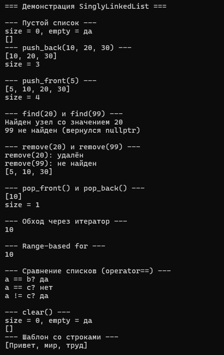
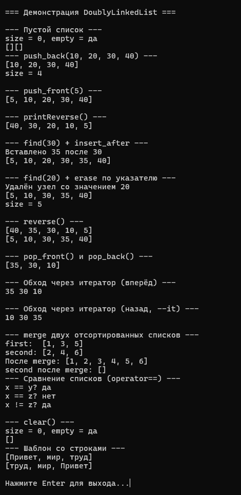

# Лабораторная работа №4: Односвязный и двусвязный списки

**Студент:** Лещинский П.А.

**Группа:** ПИЖ-б-о-25-2(2)

**Вариант:** 2

**Дисциплина:** «Алгоритмы и структуры данных»

**Тема:** «Односвязный и двусвязный списки»

---

## Цель работы

1. Реализовать шаблонный класс односвязного списка (SinglyLinkedList) с базовыми операциями.
2. Реализовать шаблонный класс двусвязного списка (DoublyLinkedList) с базовыми операциями.
3. Освоить операции вставки, удаления, поиска и обхода элементов в списках.
4. Сравнить производительность и особенности использования односвязного и двусвязного списков.
5. Научиться правильно управлять памятью при работе со списками (удаление узлов).

---

## Теоретическая часть

**Связный список** – структура данных, в которой элементы (узлы) хранятся в памяти не подряд. Каждый узел содержит данные и указатель(и) на следующий (и/или предыдущий) узел. В отличие от массива, где элементы лежат в непрерывной области, узлы списка разбросаны по куче. Это даёт O(1) на вставку и удаление у краёв, но O(n) на доступ по индексу.

**Односвязный список.** Узел хранит `data` и `next`. Обход возможен только вперёд. Удаление из конца требует O(n), потому что нужно найти предпоследний узел. Память на узел – данные плюс один указатель.

**Двусвязный список.** Узел хранит `data`, `prev` и `next`. Обход возможен в обе стороны. Удаление с конца и по указателю – O(1). Плата – дополнительный указатель на каждый узел.

**Поля класса.** `head` – указатель на первый узел, `tail` – на последний, `count` – количество узлов. Наличие `tail` даёт `push_back` за O(1), наличие `count` – `size` за O(1).

**Управление памятью.** Каждый узел создаётся через `new` и удаляется через `delete`. Деструктор проходит по всем узлам и освобождает их – иначе утечка. При удалении узла обязательно обнулять связи у соседей, чтобы не осталось висячих указателей.

**Итераторы.** Для списка нельзя использовать `T*` как итератор – элементы не лежат подряд. Нужен отдельный класс, который хранит указатель на узел и поддерживает операции `*`, `++`, `--` (для двусвязного), `==`, `!=`. `begin()` возвращает итератор на голову, `end()` – на `nullptr` как маркер конца.

---

## Постановка задачи

Продвинутый уровень, вариант 2. Реализовать оба класса – `SinglyLinkedList` и `DoublyLinkedList` – с полной функциональностью.

Односвязный список: `push_front`, `push_back`, `pop_front`, `pop_back`, `find`, `remove`, `print`, `clear`, `size`, `empty`, forward-итератор с `begin`/`end`.

Двусвязный список: всё то же плюс `printReverse`, `insert_after`, `erase(Node*)`, `reverse`, `merge`, bidirectional-итератор.

Дополнительное требование варианта 2 – операторы сравнения `==` и `!=` для обоих классов. Дополнительная функциональность среднего уровня по варианту 2 – метод `merge` для слияния двух отсортированных двусвязных списков.

---

## Листинг программы с комментариями

Ссылки на файлы в репозитории:

- https://github.com/Fanatol/cpp-labs/blob/main/lab3-4/SinglyLinkedList.h
- https://github.com/Fanatol/cpp-labs/blob/main/lab3-4/DoublyLinkedList.h
- https://github.com/Fanatol/cpp-labs/blob/main/lab3-4/main.cpp

---

## Результаты работы

Результаты выполнения программы представлены на скриншотах.

<b>Рисунок 1 – Демонстрация работы SinglyLinkedList</b>

<b>Рисунок 2 – Демонстрация работы DoublyLinkedList</b>

---

## Анализ сложности операций

**SinglyLinkedList:**

| Операция | Сложность | Обоснование |
|----------|-----------|-------------|
| `push_front` | O(1) | Работа только с головой |
| `push_back` | O(1) | Есть указатель `tail` |
| `pop_front` | O(1) | Сдвиг `head` и удаление |
| `pop_back` | O(n) | Нужно найти предпоследний узел |
| `find` | O(n) | Обход от головы |
| `remove` | O(n) | Поиск + удаление |
| `size`, `empty` | O(1) | Возврат поля `count` |
| `clear`, деструктор | O(n) | Удаление всех узлов |
| `operator==` | O(n) | Параллельный обход |

**DoublyLinkedList:**

| Операция | Сложность | Обоснование |
|----------|-----------|-------------|
| `push_front` | O(1) | Работа с головой |
| `push_back` | O(1) | Работа с хвостом |
| `pop_front` | O(1) | Сдвиг `head` |
| `pop_back` | O(1) | От `tail` сразу к `tail->prev` |
| `find` | O(n) | Обход списка |
| `insert_after` | O(1) | Есть указатель на узел |
| `erase(Node*)` | O(1) | Есть указатель на узел |
| `reverse` | O(n) | Один проход с перестановкой указателей |
| `merge` | O(n + m) | Параллельный проход двух отсортированных списков |
| `printReverse` | O(n) | Обход от `tail` назад |
| `size`, `empty` | O(1) | Возврат `count` |
| `clear`, деструктор | O(n) | Удаление всех узлов |
| `operator==` | O(n) | Параллельный обход |

**Ключевое различие:** `pop_back` у односвязного – O(n), у двусвязного – O(1). Также вставка и удаление по указателю у двусвязного работают за O(1), потому что предшественник доступен через `prev` – не нужно искать его обходом.

---

## Ответы на контрольные вопросы

<b>1. Чем связный список отличается от динамического массива?</b>

В массиве элементы лежат в непрерывной области памяти, доступ по индексу – O(1). В списке узлы разбросаны, доступ по индексу – O(n). Но вставка и удаление у краёв у списка – O(1), у массива – O(n) из-за сдвига элементов. Память: массив хранит только данные, список – данные плюс указатели.

<b>2. Какие операции в односвязном списке выполняются за O(1)?</b>

`push_front`, `push_back` (при наличии `tail`), `pop_front`, `size`, `empty`. Все они работают только с концами списка или возвращают готовое поле без обхода.

<b>3. Почему удаление из конца односвязного списка требует O(n) времени?</b>

У последнего узла только `next = nullptr`. Чтобы удалить его корректно, нужно обнулить `next` у предпоследнего узла. А найти предпоследний можно только пройдя от `head` до узла, у которого `next == tail`. Это O(n).

<b>4. Какие преимущества даёт хранение указателя tail в односвязном списке?</b>

`push_back` становится O(1) вместо O(n) – сразу работаем с последним узлом. Плата – 8 байт в объекте списка. Без `tail` пришлось бы каждый раз идти от головы до конца.

<b>5. Чем двусвязный список отличается от односвязного?</b>

Узел двусвязного хранит два указателя – `prev` и `next`. Это позволяет идти в обе стороны и удалять узел по указателю за O(1) без поиска предшественника. Плата – 8 байт на каждый узел.

<b>6. Какие операции в двусвязном списке выполняются быстрее, чем в односвязном?</b>

`pop_back` – O(1) вместо O(n). `erase` по указателю – O(1) вместо O(n). Обход в обратном порядке – доступен напрямую через `prev`.

<b>7. Что такое «голова» (head) и «хвост» (tail) списка?</b>

`head` – указатель на первый узел, `tail` – на последний. Если список пуст, оба равны `nullptr`. Они дают быстрый доступ к концам для операций за O(1).

<b>8. Как удалить узел из середины односвязного списка?</b>

Найти предшественника удаляемого узла – идти от `head`, пока `current->next != toDelete`. Потом перекинуть `current->next = toDelete->next` и `delete toDelete`. Сложность O(n) из-за поиска.

<b>9. Как удалить узел из середины двусвязного списка? Почему это проще?</b>

Если есть указатель на узел, переставляем двух соседей: `node->prev->next = node->next` и `node->next->prev = node->prev`. Потом `delete node`. Сложность O(1) – предшественник уже доступен через `prev`.

<b>10. Что произойдёт, если забыть обновить tail при удалении?</b>

`tail` будет указывать на удалённый узел – висячий указатель. При следующем `push_back` произойдёт обращение к освобождённой памяти. Программа может упасть или вести себя непредсказуемо.

<b>11. Как реализовать реверс односвязного списка?</b>

Идём по списку, у каждого узла меняем `next` на предыдущий. Нужны три указателя: `prev`, `current`, `next`. После прохода `head` становится бывшим `tail`. В двусвязном – то же плюс обмен `prev` и `next` у каждого узла и обмен `head`/`tail`.

<b>12. Как обнаружить цикл в связном списке?</b>

Алгоритм «черепахи и зайца» (Флойда): два указателя идут с разной скоростью – один на шаг, другой на два. Если встретились – цикл есть. Если быстрый дошёл до `nullptr` – цикла нет. O(n) по времени, O(1) по памяти.

<b>13. В каких случаях стоит использовать список вместо массива?</b>

Когда много вставок и удалений в начале или середине, и при этом не нужен быстрый доступ по индексу – очереди, стеки, LRU-кэши, связные структуры. Если нужен частый доступ по индексу – лучше массив.

<b>14. Какая дополнительная память требуется для каждого узла списка?</b>

Односвязный: 8 байт на `next` (на 64-битной системе). Двусвязный: 16 байт на `prev` и `next`. Плюс накладные расходы аллокатора `new` на каждый узел.

<b>15. Почему доступ по индексу в списке имеет сложность O(n)?</b>

Узлы лежат в памяти не подряд, их адреса не связаны арифметически. Нельзя вычислить адрес i-го элемента формулой. Чтобы добраться до i-го, нужно пройти от `head` через `next` ровно i раз.

---

## Вывод

В ходе работы реализованы два шаблонных класса – `SinglyLinkedList<T>` и `DoublyLinkedList<T>` – с полным набором операций: вставка, удаление, поиск, обход, реверс, слияние. Освоены ключевые различия между односвязным и двусвязным списками: у двусвязного `pop_back` и удаление по указателю работают за O(1), у односвязного – за O(n). Реализованы итераторы: forward для односвязного, bidirectional для двусвязного, с поддержкой `begin`/`end` и range-based for. Добавлены операторы сравнения `==` и `!=` для сравнения списков по содержимому.

Проведён анализ сложности всех операций. Показано, что наличие `tail` даёт `push_back` за O(1) в обоих списках, а `prev` в двусвязном – константное удаление с конца и по указателю. Для `merge` двух отсортированных списков реализован классический алгоритм слияния за O(n + m), использующий уже имеющуюся сортировку.

Все методы корректно обрабатывают граничные случаи: пустой список, список из одного элемента, отсутствие искомого значения. Управление памятью корректно: каждый `new` сопровождается `delete`, деструктор освобождает все узлы. Программа работает без утечек и падений. Код загружен в репозиторий.

---
