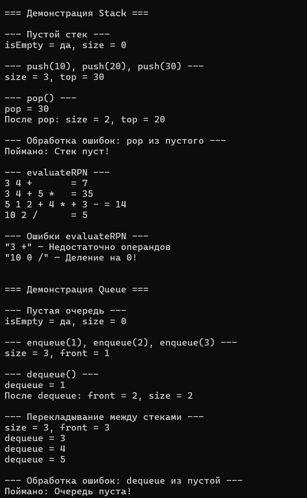
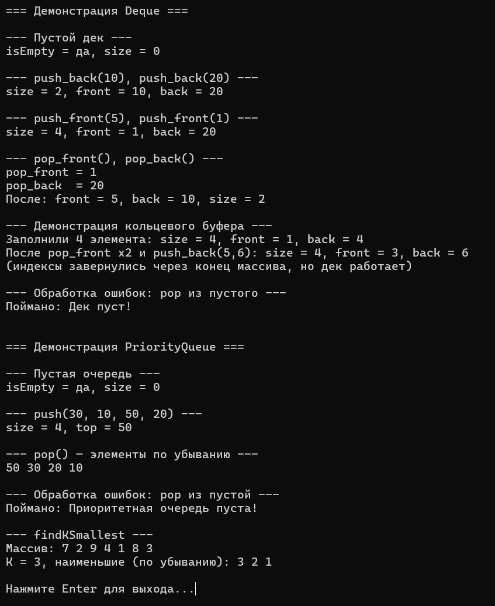

# Лабораторная работа №5: Стек, очередь, дек, приоритетная очередь

**Студент:** Лещинский П.А.

**Группа:** ПИЖ-б-о-25-2(2)

**Вариант:** 2

**Дисциплина:** «Алгоритмы и структуры данных»

**Тема:** «Стек, очередь, дек, приоритетная очередь»

---

## Цель работы

1. Освоить реализацию стека (LIFO) и его применение для вычисления выражений в обратной польской записи.
2. Освоить реализацию очереди (FIFO) и построение очереди на двух стеках.
3. Освоить реализацию дека на основе кольцевого буфера.
4. Освоить реализацию приоритетной очереди на основе двоичной кучи (max-heap).
5. Научиться правильно управлять памятью при работе с динамическими структурами данных.

---

## Теоретическая часть

**Стек** – структура данных, работающая по принципу LIFO (Last In, First Out). Элементы добавляются и извлекаются с одного конца – вершины. Реализуется на массиве с индексом `topIndex`. Операции `push`, `pop`, `top`.

**Очередь** – структура данных, работающая по принципу FIFO (First In, First Out). Добавление – в конец, извлечение – из начала. В данной работе реализована на двух стеках: `input` для добавления, `output` для извлечения. При `dequeue`, если `output` пуст, все элементы из `input` перекладываются в `output` – порядок переворачивается, и самый старый элемент оказывается на вершине `output`.

**Дек** – двусторонняя очередь, позволяет добавлять и удалять с обоих концов. Реализуется на кольцевом буфере: массив фиксированной ёмкости, где `frontIndex` указывает на первый элемент, `rearIndex` – на позицию после последнего, а индексы «заворачиваются» через `% capacity`.

**Приоритетная очередь** – структура, из которой извлекается элемент с наибольшим приоритетом (в данной работе – максимум). Реализуется на двоичной куче – дереве, уложенном в массив, где для любого узла `i` его родитель `(i - 1) / 2`, а дети – `2*i + 1` и `2*i + 2`. Правило max-heap: каждый родитель ≥ своих детей. Отсюда максимум всегда в `heap[0]`. `push` и `pop` – O(log n) за счёт `heapifyUp` / `heapifyDown`.

**Управление памятью.** Все структуры хранят данные в динамическом массиве в куче. Деструкторы освобождают память через `delete[]`.

---

## Постановка задачи

Продвинутый уровень, вариант 2. Реализовать четыре шаблонных класса с полным набором операций:

- **`Stack<T>`** – `push`, `pop`, `top`, `isEmpty`, `size`, расширение массива. Задача: вычислить выражение в обратной польской записи.
- **`Queue<T>`** – `enqueue`, `dequeue`, `front`, `isEmpty`, `size`. Реализация на двух стеках.
- **`Deque<T>`** – `push_front`, `push_back`, `pop_front`, `pop_back`, `front`, `back`, `isEmpty`, `size`. Реализация на кольцевом буфере.
- **`PriorityQueue<T>`** – `push`, `pop`, `top`, `isEmpty`, `size`. Реализация на двоичной куче (max-heap). Задача: найти K наименьших элементов в массиве.

---

## Листинг программы с комментариями

Ссылки на файлы в репозитории:

- https://github.com/Fanatol/cpp-labs/blob/main/lab3-5/Stack.h
- https://github.com/Fanatol/cpp-labs/blob/main/lab3-5/Queue.h
- https://github.com/Fanatol/cpp-labs/blob/main/lab3-5/Deque.h
- https://github.com/Fanatol/cpp-labs/blob/main/lab3-5/PriorityQueue.h
- https://github.com/Fanatol/cpp-labs/blob/main/lab3-5/main.cpp

---

## Результаты работы

Результаты выполнения программы представлены на скриншотах.

<b>Рисунок 1 – Демонстрация работы Stack и Queue</b>

<b>Рисунок 2 – Демонстрация работы Deque и PriorityQueue</b>

---

## Анализ сложности операций

**Stack:**

| Операция | Сложность | Обоснование |
|----------|-----------|-------------|
| `push` | O(1) амортизированно | Запись в `data[++topIndex]`, при переполнении – расширение O(n) |
| `pop` | O(1) | Чтение и уменьшение `topIndex` |
| `top` | O(1) | Возврат `data[topIndex]` |
| `isEmpty`, `size` | O(1) | Возврат полей |
| `evaluateRPN` | O(n) | Один проход по токенам |

**Queue (на двух стеках):**

| Операция | Сложность | Обоснование |
|----------|-----------|-------------|
| `enqueue` | O(1) | `push` в `input` |
| `dequeue` | O(1) амортизированно | Иногда O(n) при перекладывании, но каждый элемент перекладывается не более одного раза |
| `front` | O(1) амортизированно | То же |
| `isEmpty`, `size` | O(1) | Проверка обоих стеков |

**Deque (кольцевой буфер):**

| Операция | Сложность | Обоснование |
|----------|-----------|-------------|
| `push_front`, `push_back` | O(1) амортизированно | Сдвиг индекса + запись, расширение O(n) |
| `pop_front`, `pop_back` | O(1) | Сдвиг индекса |
| `front`, `back` | O(1) | Доступ по индексу |
| `isEmpty`, `size` | O(1) | Возврат полей |

**PriorityQueue (max-heap):**

| Операция | Сложность | Обоснование |
|----------|-----------|-------------|
| `push` | O(log n) | `heapifyUp` – подъём по высоте дерева |
| `pop` | O(log n) | `heapifyDown` – спуск по высоте дерева |
| `top` | O(1) | Возврат корня `heap[0]` |
| `isEmpty`, `size` | O(1) | Возврат полей |
| `findKSmallest` | O(n log k) | n элементов, каждый `push`/`pop` за O(log k) |

---

## Ответы на контрольные вопросы

<b>1. В чём заключается принцип работы стека (LIFO)?</b>

Стек работает по принципу «последним пришёл – первым вышел». Элементы добавляются и извлекаются только с одного конца – вершины. Аналогия: стопка тарелок. Если положить `10`, `20`, `30`, то `pop` сначала вернёт `30`, потом `20`, потом `10`.

<b>2. В чём заключается принцип работы очереди (FIFO)?</b>

Очередь работает по принципу «первым пришёл – первым вышел». Добавление в конец, извлечение из начала. Аналогия: очередь в магазине. Если положить `1`, `2`, `3`, то `dequeue` вернёт `1`, потом `2`, потом `3`.

<b>3. Чем дек отличается от обычной очереди?</b>

Дек позволяет добавлять и удалять элементы **с обоих концов** за O(1). У обычной очереди – только с одного конца добавлять, с другого извлекать. Дек – это двусторонняя очередь.

<b>4. Что такое приоритетная очередь? Где она применяется?</b>

Структура, из которой извлекается элемент с наибольшим (или наименьшим) приоритетом. Применяется в планировщиках задач, управлении памятью, обработки событий.

<b>5. Как реализовать стек на основе динамического массива?</b>

Хранить массив `data` и индекс `topIndex` (у пустого `-1`). `push` – `data[++topIndex] = value`. `pop` – запомнить `data[topIndex]` и `topIndex--`. При переполнении (`topIndex == capacity - 1`) – расширить массив вдвое.

<b>6. Как реализовать очередь на основе кольцевого буфера?</b>

Хранить массив фиксированной ёмкости и два индекса: `frontIndex` (первый элемент) и `rearIndex` (позиция после последнего). При добавлении в конец – `data[rearIndex] = value; rearIndex = (rearIndex + 1) % capacity`. При извлечении из начала – `value = data[frontIndex]; frontIndex = (frontIndex + 1) % capacity`. Индексы «заворачиваются» через `%`.

<b>7. Почему приоритетную очередь обычно реализуют на куче?</b>

Куча даёт O(log n) на `push` и `pop` и O(1) на `top`. Альтернативы – несортированный массив (O(n) на `pop`), сортированный массив (O(n) на `push`). Куча – баланс: обе операции логарифмические. Плюс куча компактно хранится в массиве без указателей.

<b>8. Какова сложность операций push и pop в стеке?</b>

Обе – O(1). `push` – запись в `data[++topIndex]`. `pop` – чтение `data[topIndex]` и `topIndex--`. При расширении `push` – O(n), но амортизированно O(1) за счёт удвоения ёмкости.

<b>9. Какова сложность операций enqueue и dequeue в очереди?</b>

В очереди на двух стеках: `enqueue` – O(1) (`push` в `input`), `dequeue` – амортизированно O(1) (перекладывание из `input` в `output` происходит редко, каждый элемент перекладывается не более одного раза). В кольцевом буфере – обе O(1).

<b>10. Какова сложность операций в приоритетной очереди? Почему?</b>

`push` – O(log n): вставка в конец + `heapifyUp` по высоте дерева (log n). `pop` – O(log n): перемещение последнего элемента в корень + `heapifyDown` по высоте дерева. `top` – O(1): максимум всегда в `heap[0]`.

<b>11. Как проверить правильность расстановки скобок с помощью стека?</b>

Идти по строке. Открывающую скобку (`(`, `[`, `{`) класть в стек. Закрывающую – сравнивать с вершиной: если пара совпадает – `pop`, иначе – ошибка. В конце стек должен быть пуст. Сложность O(n).

<b>12. Как реализовать очередь на двух стеках? Какова сложность?</b>

`enqueue` – `push` в `input` (O(1)). `dequeue` – если `output` пуст, переложить всё из `input` в `output`, потом `pop` из `output`. Амортизированно O(1): каждый элемент перекладывается не более одного раза за всё время.

<b>13. Как реализовать дек на основе двусвязного списка?</b>

Хранить `head` и `tail`. `push_front` – вставить узел перед `head`, `push_back` – после `tail`, `pop_front`/`pop_back` – удалить крайние. Все операции – O(1). Плата – 16 байт указателей на узел.

<b>14. Как реализовать дек на основе кольцевого буфера?</b>

Массив фиксированной ёмкости с индексами `frontIndex` и `rearIndex`. `push_back` – запись в `rearIndex`, сдвиг вперёд. `push_front` – сдвиг `frontIndex` назад, запись. `pop_front`/`pop_back` – сдвиг соответствующих индексов. При переполнении – расширение с перекопированием по кругу.

<b>15. Как реализовать стек с поддержкой получения минимума за O(1)?</b>

Хранить два стека: основной и вспомогательный `minStack`, где на вершине – минимум. При `push(x)` – если `minStack` пуст или `x <= minStack.top()`, `push(x)` в `minStack`. При `pop()` – если `pop` из основного равен `minStack.top()`, `pop` и из `minStack`. Минимум – `minStack.top()`. Все операции O(1).

---

## Вывод

В ходе работы реализованы четыре структуры данных на основе динамических массивов: стек (LIFO), очередь (FIFO, на двух стеках), дек (кольцевой буфер) и приоритетная очередь (двоичная куча max-heap). Для каждой структуры реализован полный набор операций с корректной обработкой ошибок при извлечении из пустой структуры. Решены задачи варианта 2: вычисление выражения в обратной польской записи через стек, поиск K наименьших элементов через max-heap. Освоены ключевые приёмы: кольцевой буфер с индексами по модулю, перекладывание между стеками для FIFO, поддержание правила кучи через `heapifyUp`/`heapifyDown`. Проведён анализ сложности.

---

## Ссылка на Git-репозиторий

https://github.com/Fanatol/cpp-labs/tree/main/lab3-5