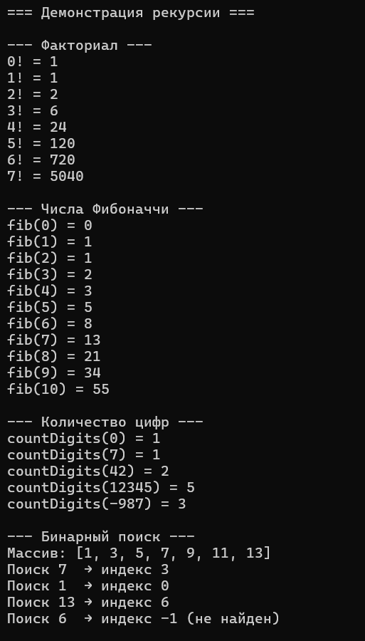
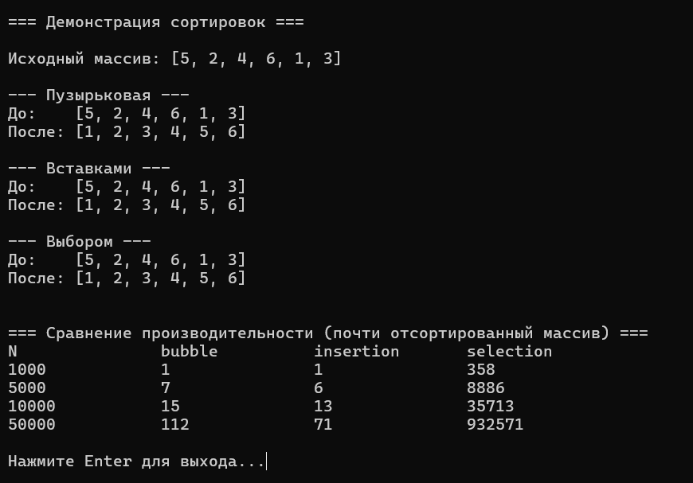

# Лабораторная работа №6: Рекурсия и простые сортировки

**Студент:** Лещинский П.А.

**Группа:** ПИЖ-б-о-25-2(2)

**Вариант:** 2

**Дисциплина:** «Алгоритмы и структуры данных»

**Тема:** «Рекурсия и простые сортировки»

---

## Цель работы

1. Освоить принципы рекурсии: прямой и косвенной, базовый случай и шаг рекурсии.
2. Научиться применять рекурсию для решения практических задач (факториал, числа Фибоначчи, Ханойские башни, обход лабиринта).
3. Реализовать и сравнить простые алгоритмы сортировки: пузырьковую, вставками, выбором.
4. Проанализировать сложность рекурсивных алгоритмов и простых сортировок.
5. Сравнить рекурсивную и итеративную реализации одних и тех же алгоритмов.

---

## Теоретическая часть

**Рекурсия** – приём, при котором функция вызывает саму себя для решения подзадачи меньшего размера. Обязательные компоненты: базовый случай (условие остановки) и шаг рекурсии (вызов с уменьшенными параметрами).

**Виды рекурсии:** прямая (функция вызывает себя), косвенная (A вызывает B, B вызывает A), хвостовая (рекурсивный вызов – последняя операция).

**Пузырьковая сортировка** – сравнивает соседние элементы, «всплывает» максимум в конец. С оптимизацией `swapped` даёт **O(n)** в лучшем случае, если массив уже отсортирован.

**Сортировка вставками** – берёт элемент и вставляет в правильное место среди уже отсортированной левой части. Лучший случай – **O(n)**.

**Сортировка выбором** – на каждом шаге ищет минимум в оставшейся части и ставит на текущую позицию. **Всегда O(n²)** – не использует отсортированность.

**Устойчивость** – сохранение относительного порядка равных элементов. Bubble и insertion – устойчивые, selection – нет.

---

## Постановка задачи

Вариант 2.

**Часть 1 – рекурсивные алгоритмы:**
- факториал числа;
- числа Фибоначчи;
- количество цифр числа;
- бинарный поиск (рекурсивно).

**Часть 2 – простые сортировки:**
- пузырьковая;
- вставками;
- выбором;
- дополнительное задание: сравнить на почти отсортированном массиве.

---

## Листинг программы с комментариями

Ссылки на файлы в репозитории:

- https://github.com/Fanatol/cpp-labs/blob/main/lab3-6/Recursion.h
- https://github.com/Fanatol/cpp-labs/blob/main/lab3-6/Sorts.h
- https://github.com/Fanatol/cpp-labs/blob/main/lab3-6/main.cpp

---

## Результаты работы

Результаты выполнения программы представлены на скриншотах.

<b>Рисунок 1 – Демонстрация рекурсии и сортировок</b>

<b>Рисунок 2 – Сравнение производительности сортировок</b>

---

## Анализ сложности рекурсивных алгоритмов

| Функция | Сложность | Обоснование |
|---------|-----------|-------------|
| `factorial(n)` | O(n) | Один рекурсивный вызов на каждом уровне, глубина n |
| `fib(n)` | O(2ⁿ) | Каждый вызов порождает два новых, дерево растёт экспоненциально |
| `countDigits(n)` | O(log n) | Количество рекурсивных вызовов = количество цифр числа |
| `binarySearch(arr, left, right, target)` | O(log n) | На каждом шаге диапазон сужается вдвое |

---

## Сравнительная таблица сортировок

| Алгоритм | Лучший | Средний | Худший | Память | Устойчивость |
|----------|--------|---------|--------|--------|--------------|
| Пузырьковая | O(n) | O(n²) | O(n²) | O(1) | Да |
| Вставками | O(n) | O(n²) | O(n²) | O(1) | Да |
| Выбором | O(n²) | O(n²) | O(n²) | O(1) | Нет |

**Результаты замеров** на почти отсортированном массиве (время в мкс):

| N | bubble | insertion | selection |
|---|---|---|---|
| 1000 | 1 | 1 | 719 |
| 5000 | 69 | 22 | 11721 |
| 10000 | 15 | 13 | 35587 |
| 50000 | 77 | 67 | 958160 |

---

## Ответы на контрольные вопросы

<b>1. Что такое рекурсия? Из каких компонентов состоит рекурсивная функция?</b>

Рекурсия – приём, при котором функция вызывает саму себя для подзадачи меньшего размера. Компоненты: базовый случай (условие остановки), шаг рекурсии (вызов с уменьшенными параметрами, приближающий к базовому случаю).

<b>2. Что такое базовый случай рекурсии? Почему он важен?</b>

Базовый случай – условие, при котором рекурсия останавливается и возвращает результат без нового вызова. Без него – бесконечная рекурсия и переполнение стека. Например, для факториала: `if (n <= 1) return 1;`.

<b>3. Чем отличается прямая рекурсия от косвенной?</b>

Прямая – функция вызывает саму себя напрямую (`factorial(n)` вызывает `factorial(n-1)`). Косвенная – через цепочку других функций: A вызывает B, B вызывает A (`isEven(n) → isOdd(n-1) → isEven(n-2)`).

<b>4. Что такое хвостовая рекурсия? В чём её преимущество?</b>

Хвостовая рекурсия – рекурсивный вызов является **последней операцией** функции (например, с аккумулятором). Преимущество: компилятор может оптимизировать её в цикл, не наращивая стек. Это даёт O(1) по памяти вместо O(n).

<b>5. Какова временная сложность рекурсивного вычисления чисел Фибоначчи? Почему?</b>

O(2ⁿ). Каждый вызов `fib(n)` порождает два новых: `fib(n-1)` и `fib(n-2)`. Дерево вызовов растёт экспоненциально. Для n = 40 – около миллиарда вызовов.

<b>6. Как можно оптимизировать рекурсивное вычисление Фибоначчи?</b>

Мемоизация – сохранять уже вычисленные значения в массив или хеш-таблицу, чтобы не пересчитывать. Тогда O(n) по времени и O(n) по памяти. Или перейти на итеративную версию с двумя переменными (`a`, `b`) – O(n) по времени, O(1) по памяти.

<b>7. В чём отличие рекурсивной реализации от итеративной?</b>

Рекурсивная – короче, ближе к математическому определению, но использует стек. Итеративная – через цикл, эффективнее по памяти, но иногда менее наглядна. Любую рекурсию можно переписать итеративно.

<b>8. Какова сложность пузырьковой сортировки? Когда она становится O(n)?</b>

В среднем и худшем – O(n²). Становится **O(n)** в лучшем случае, если массив уже отсортирован и используется оптимизация `swapped`: за первый проход нет обменов → `break`. Без `swapped` – всегда O(n²).

<b>9. Чем сортировка вставками отличается от сортировки выбором?</b>

Вставками – берёт элемент и «вдвигает» его в правильное место в уже отсортированной части. На почти отсортированном массиве – почти без сдвигов, O(n). Выбором – ищет минимум в оставшейся части и ставит на текущую позицию. Всегда O(n²) – не использует отсортированность.

<b>10. Какая из простых сортировок является устойчивой? Что это значит?</b>

Пузырьковая и вставками – устойчивые. Устойчивость – сохранение относительного порядка равных элементов. Если в исходном массиве `A` стоял раньше `B` и у них одинаковый ключ – после сортировки `A` будет раньше `B`. Выбором – неустойчивая (обмен может переставить равные).

<b>11. Какая из простых сортировок работает лучше на почти отсортированных данных?</b>

Вставками и пузырьковая (с `swapped`) – **O(n)**. Обе за один-два прохода исправляют локальные нарушения.

<b>12. Как реализовать пузырьковую сортировку с оптимизацией?</b>

Добавить флаг `swapped` в начале каждого прохода. При обмене – `swapped = true`. После прохода: если `swapped == false` – массив уже отсортирован, `break`. Это даёт лучший случай O(n).

<b>13. Что такое рекурсивный поиск с возвратом (backtracking)?</b>

Алгоритм, который пробует один вариант, и если он не подходит – «возвращается» и пробует другой. Рекурсивно перебирает все возможные варианты, отсекая тупиковые. Применяется для обхода лабиринта, задачи о ферзях, судоку, генерации перестановок.

<b>14. Как рекурсивно обойти лабиринт?</b>

Из текущей клетки: проверить, что она в пределах, не стена и не посещена. Если финиш – успех. Иначе пометить как посещённую и рекурсивно попробовать 4 направления (вверх, вниз, влево, вправо). Если ни одно не привело к успеху – вернуться (backtracking). Сложность – O(количество клеток).

<b>15. Какова сложность Ханойских башен? Сколько ходов нужно для перемещения n дисков?</b>

**O(2ⁿ)** – экспоненциальная. Минимальное количество ходов – **2ⁿ − 1**.

---

## Вывод

В ходе работы реализованы четыре рекурсивные функции: факториал, числа Фибоначчи, количество цифр, бинарный поиск. Освоены принципы рекурсии: базовый случай и шаг, стек вызовов. Реализованы три простые сортировки: пузырьковая, вставками, выбором.

Проведено сравнение на почти отсортированном массиве (доп. задание варианта 2). Результаты показали: bubble и insertion работают за O(n) – микросекунды даже на 50000 элементов; selection – за O(n²) – почти секунда на 50000. Разница – почти в 12000 раз.

---

## Ссылка на Git-репозиторий

https://github.com/Fanatol/cpp-labs/tree/main/lab3-6