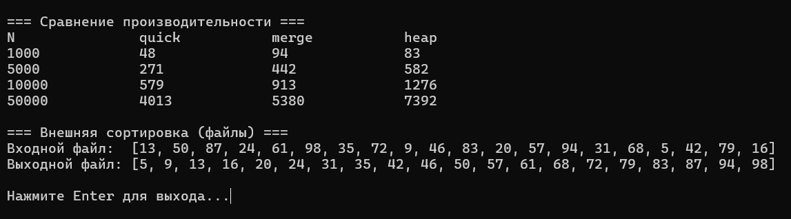

# Лабораторная работа №7: Быстрая сортировка, сортировка слиянием, пирамидальная сортировка

Студент: Лещинский П.А.

Группа: ПИЖ-б-о-25-2(2)

Вариант: 2

Дисциплина: «Алгоритмы и структуры данных»

Тема: «Быстрая сортировка, сортировка слиянием, пирамидальная сортировка»

---

## Цель работы

1. Реализовать три эффективных алгоритма сортировки: быструю сортировку (Quick Sort), сортировку слиянием (Merge Sort) и пирамидальную сортировку (Heap Sort).
2. Освоить принципы «разделяй и властвуй» на примере быстрой сортировки и сортировки слиянием.
3. Изучить структуру данных «куча» (heap) для реализации пирамидальной сортировки.
4. Проанализировать и сравнить производительность различных алгоритмов сортировки.
5. Понять преимущества и недостатки каждого алгоритма в различных сценариях использования.

---

## Теоретическая часть

Quick Sort использует принцип «разделяй и властвуй». Выбирается опорный элемент (pivot), массив переставляется так, чтобы слева от pivot были элементы не больше него, справа – не меньше. После разделения pivot стоит на окончательном месте, а левая и правая части сортируются рекурсивно. В среднем O(n log n), в худшем O(n²), если pivot всегда оказывается минимумом или максимумом. Для защиты от худшего случая применяется выбор pivot как медианы из трёх (начало, середина, конец). Память O(log n) из-за рекурсии. Неустойчивая.

Merge Sort делит массив пополам, рекурсивно сортирует каждую половину, затем сливает две отсортированные половины в одну. Всегда O(n log n), независимо от исходных данных. Требует O(n) дополнительной памяти для временных массивов при слиянии. Устойчивая.

Heap Sort использует двоичную кучу – дерево, уложенное в массив, где для любого узла i родитель имеет индекс (i - 1) / 2, а дети – 2i + 1 и 2i + 2. Правило max-heap: каждый родитель больше или равен своим детям, поэтому максимум всегда в корне. Сортировка состоит из двух этапов: построение кучи из массива и извлечение максимума n-1 раз. Всегда O(n log n), память O(1) – сортировка на месте. Неустойчивая.

Внешняя сортировка применяется, когда файл не помещается в оперативную память. Используется подход на основе Merge Sort: файл читается кусками, каждый кусок сортируется в памяти и записывается во временный файл, затем все временные файлы сливаются в один выходной. В памяти в каждый момент находится только один кусок или по одному числу с каждого временного файла.

---

## Постановка задачи

Вариант 2. Реализовать три сортировки и внешнюю сортировку.

Часть 1 – три эффективные сортировки:
- Quick Sort с оптимизацией выбора опорного элемента (медиана из трёх);
- Merge Sort;
- Heap Sort.

Часть 2 – внешняя сортировка слиянием для файлов (дополнительное требование варианта 2).

Провести сравнение производительности трёх сортировок на массивах размеров 1000, 5000, 10000, 50000.

---

## Листинг программы с комментариями

Ссылки на файлы в репозитории:

- https://github.com/Fanatol/cpp-labs/blob/main/lab3-7/Sorts.h
- https://github.com/Fanatol/cpp-labs/blob/main/lab3-7/ExternalSort.h
- https://github.com/Fanatol/cpp-labs/blob/main/lab3-7/main.cpp

---

## Результаты работы

Результаты выполнения программы представлены на скриншотах.

Рисунок 1 – Сравнение производительности трёх сортировок и внешняя сортировка

---

## Анализ сложности для каждого алгоритма

| Алгоритм | Лучший | Средний | Худший | Память | Устойчивость |
|---|---|---|---|---|---|
| Quick Sort | O(n log n) | O(n log n) | O(n²) | O(log n) | Нет |
| Merge Sort | O(n log n) | O(n log n) | O(n log n) | O(n) | Да |
| Heap Sort | O(n log n) | O(n log n) | O(n log n) | O(1) | Нет |

## Сравнительная таблица производительности

Результаты замеров на детерминированных псевдослучайных массивах (время в мкс):

| N | quick | merge | heap |
|---|---|---|---|
| 1000 | 59 | 140 | 93 |
| 5000 | 254 | 508 | 581 |
| 10000 | 619 | 1133 | 1219 |
| 50000 | 3399 | 4915 | 6752 |

---

## Ответы на контрольные вопросы

1. Какова сложность быстрой сортировки в лучшем, среднем и худшем случае?

Лучший и средний – O(n log n). Худший – O(n²), когда pivot всегда минимум или максимум, и разделение даёт части размера 0 и n-1.

2. Когда возникает худший случай для быстрой сортировки?

Когда pivot оказывается минимумом или максимумом на каждом шаге. Классический пример – pivot выбирается как последний элемент, а массив уже отсортирован. Тогда глубина рекурсии n, и каждый уровень требует O(n) работы.

3. Как можно улучшить быструю сортировку для защиты от худшего случая?

Выбирать pivot не как крайний элемент, а как медиану из трёх (начало, середина, конец) или случайный элемент. Медиана из трёх – практический компромисс: вероятность худшего случая мала, дополнительных накладных расходов немного.

4. Какова сложность сортировки слиянием? Почему она всегда O(n log n)?

Всегда O(n log n), потому что деление пополам даёт ровно log n уровней рекурсии (не зависит от данных), а слияние на каждом уровне требует O(n) работы. Худшего случая нет – алгоритм не зависит от исходного порядка.

5. Какие преимущества и недостатки имеет сортировка слиянием перед быстрой?

Преимущества: гарантированно O(n log n) в худшем случае, устойчивая, хорошо работает с последовательным доступом (связные списки, файлы). Недостатки: требует O(n) дополнительной памяти, на практике медленнее Quick Sort из-за копирования.

6. Как работает пирамидальная сортировка? Какова её сложность?

Сначала из массива строится max-heap – перестановка элементов так, чтобы каждый родитель был не меньше детей. Максимум оказывается в корне (arr[0]). Затем n-1 раз: максимум меняется с последним элементом, размер кучи уменьшается, heapify восстанавливает правило кучи. Сложность всегда O(n log n), память O(1).

7. Какая из трёх сортировок устойчивая? Почему?

Merge Sort – единственная устойчивая. При слиянии, если L[i] == R[j], берётся элемент из левой части. Порядок равных элементов сохраняется. Quick Sort и Heap Sort неустойчивые – обмены перескакивают через равные элементы.

8. Какая из трёх сортировок требует дополнительной памяти? Сколько?

Merge Sort – O(n) для временных массивов при слиянии. Quick Sort – O(log n) из-за стека рекурсии. Heap Sort – O(1), сортировка на месте.

9. Какая из трёх сортировок лучше работает на почти отсортированных данных?

Merge Sort и Heap Sort – стабильно O(n log n), независимо от исходного порядка. Quick Sort с медианой из трёх тоже хорошо работает на почти отсортированных. Без оптимизации pivot Quick Sort деградировал бы до O(n²) на отсортированных данных.

10. Зачем в пирамидальной сортировке сначала строится куча?

Чтобы максимум всего массива оказался в корне (arr[0]). После этого извлечение максимума – O(1) для доступа, O(log n) для восстановления кучи. Без построения кучи пришлось бы искать максимум перебором за O(n) на каждом шаге, что дало бы O(n²).

11. Что такое «разделяй и властвуй»? Как он применяется в быстрой сортировке и сортировке слиянием?

Принцип: разделить задачу на подзадачи меньшего размера, решить каждую (рекурсивно), объединить решения. В Quick Sort: разделить массив вокруг pivot, рекурсивно отсортировать части (объединять не нужно – после разделения всё уже на местах). В Merge Sort: разделить пополам, рекурсивно отсортировать, слить (объединение – обязательный шаг).

12. Можно ли реализовать быструю сортировку итеративно (без рекурсии)?

Да, через явный стек (vector или массив), в который кладутся пары (low, high) для обработки. Вместо рекурсивного вызова – push в стек.

13. Почему быстрая сортировка обычно быстрее сортировки слиянием на практике?

Из-за локальности кэша и меньших накладных расходов. Quick Sort работает на месте (без new/delete), обмены идут по последовательным индексам. Merge Sort на каждом слиянии выделяет память, копирует элементы в L и R, потом обратно – это дорого.

14. Когда выгодно использовать пирамидальную сортировку?

Когда память ограничена (O(1) дополнительной памяти) или когда нужна гарантия O(n log n) в худшем случае. Например, встраиваемые системы.

15. Какой алгоритм сортировки вы бы выбрали для встроенных систем с ограниченной памятью?

Heap Sort – O(1) дополнительной памяти, всегда O(n log n). Если данных мало и важна устойчивость – Merge Sort, но O(n) памяти может быть проблемой. Quick Sort тоже подходит, но нужно быть уверенным в хорошем pivot.

---

## Вывод

В ходе работы реализованы три эффективные сортировки: Quick Sort с оптимизацией «медиана из трёх», Merge Sort и Heap Sort. Освоены принципы «разделяй и властвуй» и структура кучи. Реализована внешняя сортировка слиянием для файлов – вариант 2 продвинутого уровня.

Проведено сравнение производительности на массивах размеров 1000–50000. Quick Sort оказался самым быстрым на практике (3399 мкс на N = 50000), Merge Sort – вторым (4915 мкс), Heap Sort – самым медленным (6752 мкс). Все три растут как O(n log n), но с разными константами: у Quick – лучшая локальность кэша, у Merge – накладные на копирование, у Heap – плохая локальность из-за «прыжков» по индексам.

Внешняя сортировка корректно работает на тестовом файле. Программа компилируется без ошибок, утечек памяти нет, временные файлы удаляются после завершения. Код загружен в репозиторий.

---

## Ссылка на Git-репозиторий

https://github.com/Fanatol/cpp-labs/tree/main/lab3-7