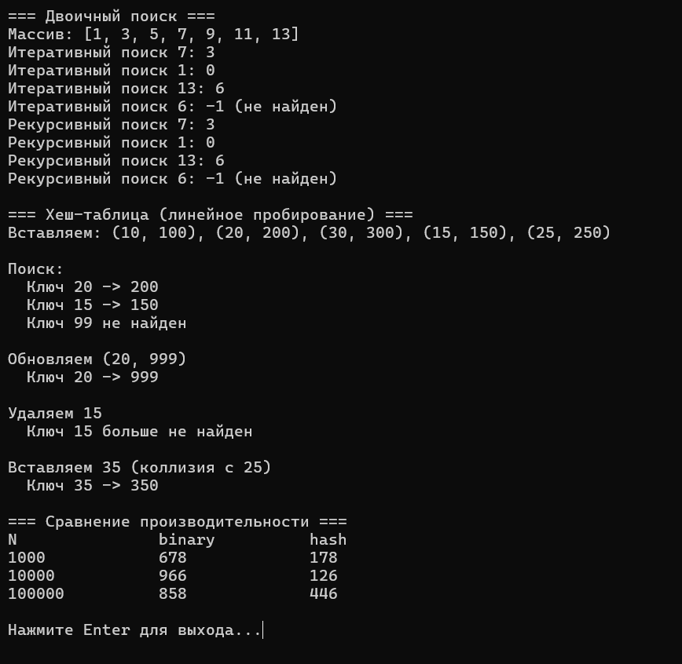

# Лабораторная работа №8: Двоичный поиск. Хеш-таблицы

Студент: Лещинский П.А.

Группа: ПИЖ-б-о-25-2(2)

Вариант: 2

Дисциплина: «Алгоритмы и структуры данных»

Тема: «Двоичный поиск. Хеш-таблицы»

---

## Цель работы

1. Реализовать алгоритм двоичного (бинарного) поиска в отсортированном массиве.
2. Освоить итеративную и рекурсивную реализации двоичного поиска.
3. Изучить понятие хеш-таблицы, хеш-функции и методы разрешения коллизий.
4. Реализовать хеш-таблицу с методом цепочек и открытой адресацией.
5. Сравнить производительность двоичного поиска и хеш-таблицы.

---

## Теоретическая часть

Двоичный поиск работает только на отсортированном массиве. На каждом шаге берётся средний элемент области поиска и сравнивается с искомым. Если равно – нашли. Если искомое меньше – поиск продолжается в левой половине, если больше – в правой. После каждого сравнения половина области отбрасывается, поэтому сложность O(log n).

Середину нужно вычислять как left + (right - left) / 2, а не (left + right) / 2. Вторая формула может переполнить int при больших left и right, первая – нет.

Хеш-таблица хранит пары ключ-значение и поддерживает вставку, поиск и удаление в среднем за O(1). По ключу вычисляется хеш – индекс ячейки массива (бакета). Если двум ключам соответствует один индекс, это коллизия. Коллизии разрешаются методом цепочек (в каждой ячейке связный список) или открытой адресацией (поиск следующей свободной ячейки).

Вариант 2 использует линейное пробирование: при коллизии проверяется следующая ячейка (hash + i) % size, i = 0, 1, 2... Каждая ячейка хранит ключ, значение, флаг занятости occupied и флаг удаления deleted.

Удаление при линейном пробировании нельзя делать простым обнулением occupied – разорвётся цепочка пробирования, и элементы, вставленные после удаляемого, станут невидимыми для поиска. Используется ленивое удаление: ставится флаг deleted, find проходит через такие ячейки, insert может их переиспользовать.

---

## Постановка задачи

Часть 1 – двоичный поиск: тип int, рекурсивная реализация. Для сравнения в части 3 – итеративная версия.

Часть 2 – хеш-таблица: линейное пробирование, ключ int, значение int. Операции insert, find, remove.

Часть 3 – сравнить производительность поиска в отсортированном массиве и в хеш-таблице для N = 1000, 10000, 100000.

---

## Листинг программы с комментариями

Ссылки на файлы в репозитории:

- https://github.com/Fanatol/cpp-labs/blob/main/lab3-8/BinarySearch.h
- https://github.com/Fanatol/cpp-labs/blob/main/lab3-8/HashTable.h
- https://github.com/Fanatol/cpp-labs/blob/main/lab3-8/main.cpp

---

## Результаты работы

Результаты выполнения программы представлены на скриншоте.

Рисунок 1 – Демонстрация и сравнение производительности

---

## Сравнительная таблица производительности

Результаты замеров 10000 запросов поиска для N = 1000, 10000, 100000 (время в мкс):

| N | Двоичный поиск | Хеш-таблица |
|---|---|---|
| 1000 | 678 | 178 |
| 10000 | 966 | 126 |
| 100000 | 858 | 446 |

---

## Ответы на контрольные вопросы

1. Какое условие необходимо для применения двоичного поиска?

Массив должен быть отсортирован. Без порядка невозможно отбросить половину области – не знаешь, в какой половине искать.

2. Какова сложность двоичного поиска? Почему она логарифмическая?

O(log n). На каждом шаге область поиска уменьшается вдвое. Количество делений n пополам до 1 – это log₂ n. Для 1 000 000 – около 20 шагов. Для 2 000 000 – около 21.

3. В чём разница между итеративной и рекурсивной реализацией двоичного поиска?

Логика одинаковая. Итеративная использует цикл с двумя указателями left и right, память O(1). Рекурсивная вызывает себя с новыми границами, память O(log n) из-за стека. Итеративная эффективнее по памяти.

4. Чем опасен вариант mid = (left + right) / 2? Как правильно вычислять середину?

(left + right) может переполнить int при больших left и right (массив на 1.5+ млрд элементов), mid станет отрицательным – выход за границы. Правильно: left + (right - left) / 2 – разница всегда влезает в int.

5. Что такое хеш-таблица? Из каких компонентов она состоит?

Структура для хранения пар ключ-значение с операциями O(1) в среднем. Компоненты: массив бакетов, хеш-функция, механизм разрешения коллизий.

6. Какие требования предъявляются к хеш-функции?

Детерминированность (один ключ – один хеш), равномерное распределение (минимум коллизий), быстрое вычисление.

7. Что такое коллизия в хеш-таблице? Как с ней бороться?

Ситуация, когда разные ключи дают одинаковый индекс. Разрешается методом цепочек (список в каждой ячейке) или открытой адресацией (поиск следующей свободной ячейки).

8. В чём отличие метода цепочек от открытой адресации?

Цепочки: в ячейке хранится список, элементы могут быть в любом количестве, дополнительная память на указатели. Открытая адресация: всё в одном массиве, при коллизии ищем следующую свободную ячейку, память только под массив, но возможна кластеризация.

9. Что такое первичная и вторичная кластеризация?

Первичная – при линейном пробировании занятые ячейки слипаются в длинные блоки, поиск замедляется. Вторичная – при квадратичном пробировании, кластеры меньше, но всё равно есть.

10. Какова средняя и худшая сложность операций в хеш-таблице?

Средняя: вставка, поиск, удаление – O(1). Худшая: O(n), если все ключи дают одну коллизию и хранятся в одном списке (или заполняют весь кластер).

11. Когда эффективнее использовать двоичный поиск, а когда хеш-таблицу?

Двоичный – когда данные статичны (отсортированы и только читаются), мало памяти. Хеш-таблица – когда частые вставки и поиск, память не критична.

12. Что такое коэффициент загрузки хеш-таблицы? Почему он важен?

Отношение count / size. При высоком коэффициенте много коллизий, поиск замедляется. Обычно держат 0.5–0.75, при превышении расширяют таблицу (рехеширование).

13. Как работает рехеширование (динамическое расширение хеш-таблицы)?

Создаётся новый массив в 2 раза больше, все элементы переносятся с новым хешированием (hash % new_size), старый массив освобождается.

14. Как выбрать размер хеш-таблицы? Почему часто выбирают простое число?

Размер должен быть больше ожидаемого количества элементов (load factor < 1). Простое число даёт более равномерное распределение, потому что key % size реже даёт общие делители с ключами.

15. Как реализовать хеш-функцию для строк?

Полиномиальный хеш: hash = (hash * 31 + c) % size для каждого символа. 31 – простое число, хорошо распределяет. Используется в std::hash для строк.

---

## Вывод

В ходе работы реализованы рекурсивная и итеративная версии двоичного поиска, а также хеш-таблица с линейным пробированием и ленивым удалением. Освоены принципы работы хеш-функций и методы разрешения коллизий.

Проведено сравнение производительности для N = 1000, 10000, 100000. Хеш-таблица стабильно быстрее в 4–5 раз. Время двоичного поиска растёт логарифмически, хеш-таблица в среднем работает за O(1) – это подтверждает теорию. Разброс у хеш-таблицы объясняется кластеризацией при линейном пробировании: на больших N кластеры длиннее, поиск дольше.

---

## Ссылка на Git-репозиторий

https://github.com/Fanatol/cpp-labs/tree/main/lab3-8