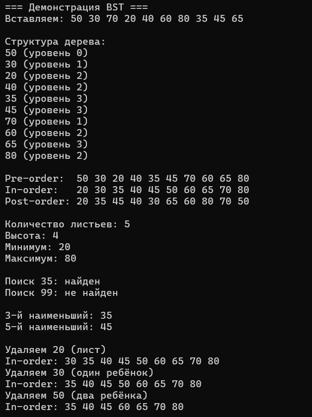
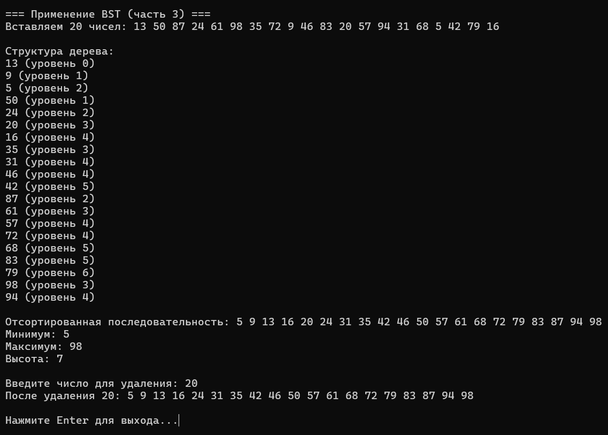

# Лабораторная работа №9: Бинарное дерево. Бинарное дерево поиска

Студент: Лещинский П.А.

Группа: ПИЖ-б-о-25-2(2)

Вариант: 2

Дисциплина: «Алгоритмы и структуры данных»

Тема: «Бинарное дерево. Бинарное дерево поиска»

---

## Цель работы

1. Реализовать структуру данных «бинарное дерево» и изучить различные способы его обхода (прямой, симметричный, обратный, уровневый).
2. Реализовать бинарное дерево поиска (BST) с операциями вставки, удаления и поиска.
3. Освоить применение рекурсии для работы с деревьями.
4. Проанализировать сложность операций в BST.
5. Научиться визуализировать структуру дерева.

---

## Теоретическая часть

Бинарное дерево – иерархическая структура, в которой каждый узел имеет не более двух потомков: левого и правого. Узел хранит значение и два указателя на детей. Узел без детей – лист. Верхний узел – корень. Высота – максимальное расстояние от корня до листа.

Обходы бинарного дерева: pre-order (корень → левый → правый), in-order (левый → корень → правый), post-order (левый → правый → корень). Все три реализуются рекурсивно и имеют сложность O(n).

Бинарное дерево поиска (BST) – это бинарное дерево, в котором для каждого узла выполняется правило: все ключи в левом поддереве меньше ключа узла, все ключи в правом поддереве больше. Из этого правила следуют два важных свойства: симметричный обход даёт отсортированную последовательность, а операции поиска, вставки и удаления в среднем работают за O(log n).

---

## Постановка задачи

Вариант 2.

Часть 1 – бинарное дерево и обходы: preOrder, inOrder, postOrder. Дополнительное задание – вычислить количество листьев.

Часть 2 – BST: insert, search, inOrder. Дополнительное задание – найти k-й наименьший элемент.

Часть 3 – применение BST: BST из 20 чисел, симметричный обход (отсортированная последовательность), поиск минимума и максимума, высота, удаление элемента по вводу пользователя.

---

## Листинг программы с комментариями

Ссылка на файл в репозитории:

https://github.com/Fanatol/cpp-labs/blob/main/lab3-9/BST.h

https://github.com/Fanatol/cpp-labs/blob/main/lab3-9/main.cpp

---

## Результаты работы

Результаты выполнения программы представлены на скриншоте.

Рисунок 1 – Демонстрация BST: структура, обходы, характеристики, операции

Рисунок 2 – Применение BST (часть 3)

---

## Анализ сложности операций

| Операция                     | Средний случай | Худший случай | Обоснование                |
| ---------------------------- | -------------- | ------------- | -------------------------- |
| preOrder, inOrder, postOrder | O(n)           | O(n)          | Обход всех узлов           |
| countLeaves                  | O(n)           | O(n)          | Обход всех узлов           |
| height                       | O(n)           | O(n)          | Обход всех узлов           |
| insert                       | O(log n)       | O(n)          | Зависит от высоты          |
| search                       | O(log n)       | O(n)          | Зависит от высоты          |
| remove                       | O(log n)       | O(n)          | Зависит от высоты          |
| findMin, findMax             | O(log n)       | O(n)          | Идём влево/вправо до конца |
| findKthSmallest              | O(h + k)       | O(n)          | In-order, остановка на k-м |
| destroy                      | O(n)           | O(n)          | Post-order удаление        |

---

## Ответы на контрольные вопросы

1. Что такое бинарное дерево? Из каких элементов оно состоит?

Иерархическая структура, где каждый узел имеет не более двух детей. Состоит из узлов, каждый хранит значение и два указателя (left, right). Верхний узел – корень, узлы без детей – листья.

2. В чём отличие бинарного дерева от бинарного дерева поиска (BST)?

Бинарное дерево – просто структура без правила. BST – частный случай с правилом: левое поддерево меньше узла, правое больше. Это даёт быстрый поиск и отсортированный in-order.

3. Какие существуют виды обхода бинарного дерева? В чём их особенности?

Pre-order (корень → левый → правый) – используется для копирования. In-order (левый → корень → правый) – для BST даёт отсортированную последовательность. Post-order (левый → правый → корень) – для удаления дерева. Level-order – по уровням, требует очереди.

4. Какой обход даёт отсортированную последовательность для BST?

In-order (симметричный). По правилу BST левое поддерево меньше узла, правое больше – значит, посещение «левый → узел → правый» даёт элементы по возрастанию.

5. Какова сложность операций поиска, вставки и удаления в BST? От чего она зависит?

В среднем O(log n), в худшем O(n). Зависит от высоты дерева. Сбалансированное дерево – высота log n, вырожденное – n.

6. Что происходит с BST, если вставлять элементы в отсортированном порядке?

Дерево становится вырожденным – каждый новый узел идёт только вправо (или только влево). Высота становится O(n), операции деградируют до O(n).

7. Какие три случая нужно рассмотреть при удалении узла из BST?

1. Узел – лист: просто удалить. 2. Узел с одним ребёнком: вернуть ребёнка на место узла. 3. Узел с двумя детьми: найти минимум в правом поддереве, скопировать значение, удалить минимум.

8. Как найти наименьший элемент в BST? Наибольший?

Наименьший – идти влево, пока есть left. Наибольший – идти вправо, пока есть right. O(h).

9. Как вычислить высоту бинарного дерева рекурсивно?

height(node) = 0, если node == nullptr; иначе 1 + max(height(left), height(right)). Обход всех узлов – O(n).

10. Что такое наименьший общий предок (LCA) двух узлов в дереве?

Самый глубокий узел, который является предком обоих узлов. В BST ищется за O(h): если оба ключа меньше узла – идём влево; если оба больше – вправо; иначе узел и есть LCA.

11. Как проверить, является ли бинарное дерево BST?

In-order обход должен давать строго возрастающую последовательность. Или рекурсивно: для каждого узла проверить, что все ключи в левом поддереве меньше, в правом – больше, передавая границы (min, max) вниз.

12. Что такое сбалансированное дерево? Почему это важно для производительности?

Дерево, у которого высота левого и правого поддеревьев различается не больше чем на 1 для каждого узла. Сбалансированное дерево даёт высоту O(log n), а значит, все операции – O(log n) вместо O(n).

13. Как преобразовать несбалансированное BST в сбалансированное?

Сделать in-order обход – получить отсортированный массив. Затем построить сбалансированное дерево из массива: средний элемент – корень, левая половина – левое поддерево, правая – правое. Рекурсивно.

14. Как восстановить дерево по массиву обхода (in-order + pre-order)?

Первый элемент pre-order – корень. Найти его в in-order – он разделяет массивы на левое и правое поддеревья. Рекурсивно повторить для каждой половины.

15. Как реализовать итеративный (не рекурсивный) обход бинарного дерева?

Через явный стек. Для in-order: идём влево, складывая узлы в стек, пока есть left; потом pop, печатаем, идём вправо. Для pre-order: stack, push корень, цикл pop → печать → push right → push left. Для post-order: два стека.

---

## Вывод

В ходе работы реализовано бинарное дерево с тремя рекурсивными обходами (pre-order, in-order, post-order) и подсчётом листьев. Также реализовано бинарное дерево поиска с операциями insert, search, remove и поиском k-го наименьшего элемента. Все операции проверены на демонстрационном дереве: обходы дают правильные последовательности, in-order для BST – отсортированную, удаление обрабатывает все три случая. Деструктор использует post-order обход, чтобы удалить все узлы без утечек.

Освоены принципы работы с деревьями через рекурсию, разница между обходами, три случая удаления в BST. Программа работает корректно, утечек памяти нет, код загружен в репозиторий.

---

## Ссылка на Git-репозиторий

https://github.com/Fanatol/cpp-labs/tree/main/lab3-9
